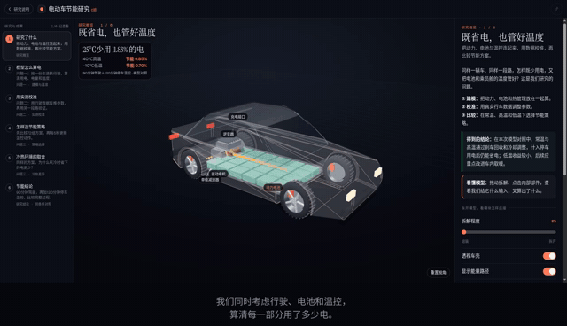

# C题 · 新能源汽车节能建模成果

2026年第二届全国大学生仿真建模应用挑战赛 · 队伍 **CSF2605207**。

我们用模型算清电动车的耗电、电量和温度，用行驶数据校准，再比较怎样回收刹车能量、怎样调节温度更省电。

## Demo · 2分55秒看懂我们的研究

上方为**22秒无声循环预览**。下方是完整视频，点击播放即可观看全部内容；如播放器默认静音，打开音量即可听到背景音乐。

### 完整视频 · 点击播放

https://github.com/user-attachments/assets/6d940969-16aa-4ca6-ab41-3dbfe4024da0

轻量播放版：**2分55秒、约7.01MB**。查看图表细节可下载下面的4K原片。

**[下载4K高清原片](CCSF2605207fz.mp4)** · [字幕](CCSF2605207fz.srt) · [视频内容与素材署名](docs/主Demo说明.md)

**4K（3840×2160） · 2分55秒 · 35.47 MB · 中文字幕与背景音乐**

视频依次展示：研究目标与结论、能耗模型、实际计算、实测校准、节能策略和冷热环境下的结果。

在同条件的“90分钟驾驶＋120分钟停车温控”模型实验中，25℃、40℃、−10℃的总节能率分别为 **11.83%、9.85%、0.70%**。这些是模型实验结果；预调温未计，实车效果仍需验证。

## 最终材料

| 文件 | 内容 |
|---|---|
| [CCSF2605207.pdf](CCSF2605207.pdf) | 最终论文 |
| [CCSF2605207fj.zip](CCSF2605207fj.zip) | 最终支撑附件 |
| [CCSF2605207fz.mp4](CCSF2605207fz.mp4) | 最终4K成果展示视频 |
| [CCSF2605207fz.srt](CCSF2605207fz.srt) | 视频字幕，方便查看文字内容 |

`main`集中放最终材料。文件大小及SHA-256见[交付清单](DELIVERY_MANIFEST.json)。视频已包含字幕和音乐；首页提供完整轻量播放器，4K原片可下载播放。

## 开发资料

- [C题研究工程：ybs-c](https://github.com/Xlovlhj/Simulation-Contest/tree/ybs-c)
- [交互展示网页源码：xqw-c-web](https://github.com/Xlovlhj/Simulation-Contest/tree/xqw-c-web)

开发分支保留各自版本。网页分支是10月20日快照，10月21日录制新增的入口和工具尚未同步；具体说明见[视频说明](docs/主Demo说明.md)。

网页画面基于[CarClear](https://glassbox.how/carclear/)改编，音乐为 Kevin MacLeod《Carefree》。原作、许可和改编范围见[素材署名](docs/主Demo说明.md#音乐来源与署名)。
