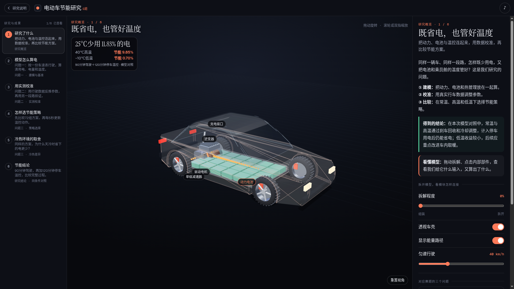

# C题 · 电动车节能研究网页

`xqw-c-web` 是独立的网页展示分支。以三维汽车、电池、道路和冷热天气，逐页讲清楚研究问题、建模方法、实测校准、策略选择与节能结论。



## 直接运行

需要Python 3.10+和支持WebGL的浏览器；网页数据、字体和Three.js均已附带，无需pip、Node或原论文支撑包。

```text
git clone --branch xqw-c-web --single-branch https://github.com/Xlovlhj/Simulation-Contest.git
cd Simulation-Contest
python3 c_web_showcase/run.py
```

浏览器打开 http://127.0.0.1:8765/ 。终端按Ctrl+C停止。服务默认只接受本机访问。
端口已占用时可执行 `python3 c_web_showcase/run.py --port 8766 --no-open`。

“可选Q1原模型复算：unavailable”不影响网页。该接口仅供持有原研究材料及已有科学计算依赖的维护者使用，不会自动安装依赖。

## 内容与资料

1. **研究了什么**：第一页先给研究目标和三温度完整过程节能结论。
2. **模型怎么算电**：从行驶需求算用电、剩余电量和温度。
3. **用实测校准**：展示模型参数如何调整，以及验证误差改善。
4. **怎样选节能策略**：72组方案比较与每5秒温控更新。
5. **冷热环境的取舍**：雪景和热浪配合解释不同温度下的收益。
6. **节能结论**：同条件、同温度目标及停车用电核查。

- [详细启动、维护和代码说明](c_web_showcase/README.md)
- [网页与视频设计方案](C题网页与视频设计方案.md)
- [材料缺口与适用范围](C题网页待确认事项.md)
- [数据结构与来源](c_web_showcase/data/README.md)
- [验证记录](c_web_showcase/checks/README.md)
- [项目计划](PROJECT_PLAN.md) / [修改记录](CHANGELOG.md)
- [上传文件清单](WEB_MANIFEST.json)

网页中的整程节能数字是已完成的模型实验结果；滑条计算给定状态，未进行新的完整行程求解。论文版本SHA-256及原作版本见[SOURCE_VERSION.json](c_web_showcase/SOURCE_VERSION.json)。

原C题研究工程另见仓库的[ybs-c分支](https://github.com/Xlovlhj/Simulation-Contest/tree/ybs-c)；该分支有自己的版本历史，不自动等同于本网页所依据的最新本地论文。网页运行无需克隆研究工程。

## 来源与许可

页面结构与三维场景改编自[CarClear](https://glassbox.how/carclear/)，[源码仓库](https://github.com/bdeeps/carclear)。原代码MIT，原内容CC BY 4.0；字体与Three.js许可随附。完整署名及改动说明见[来源说明](c_web_showcase/THIRD_PARTY_NOTICES.md)。

本分支包含当前网页及必要资产、可选维护工具和研究说明。旧仪表盘、原作视频图片、本地环境、浏览器缓存、地图私密配置及正式论文提交包未纳入。
