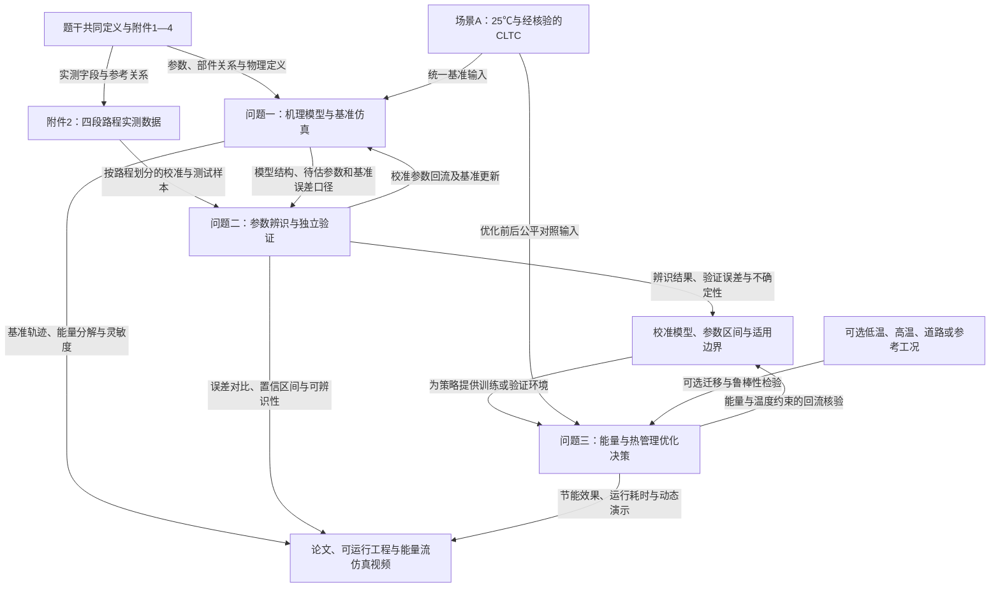

# C题：新能源汽车能量流与热管理系统仿真

## 1. 整题概览

一句话：建立一辆电动车的“动力—电池—热管理”仿真，用实测行驶数据把参数调准，再在温度、安全和舒适性等合理约束下寻找节能控制策略。

赛题来源：[C题原文](../赛题资料/C题/2026年第二届全国大学生仿真建模应用挑战赛C题.pdf)，共3页；实际题名锚点为“C 题 新能源汽车能量流与热管理系统仿真”。已核对四份Excel附件，以及共享的提交流程、论文格式规范、AI工具使用规定和承诺书。以下区分原文要求、附件观察和实施建议，不包含已经完成仿真或优化的结果。

**必须完成的三个问题**

| 问题 | 你需要做什么 | 必须给出的证据 |
|---|---|---|
| 一：建模与基准仿真 | 建立系统级集中参数机理模型；完成场景A：25℃、CLTC | 百公里能耗；SOC和温度随时间的曲线；驱动、回收、附件、损耗、冷却等能量分解；不少于5个关键参数的灵敏度分析和排序 |
| 二：数据校准 | 利用附件2辨识空气阻力系数、滚动阻力系数、电池内阻 | 校准前后SOC轨迹RMSE、能耗MAPE；至少2个参数的置信区间；参数可辨识性讨论 |
| 三：智能优化 | 控制制动回收强度、冷却启停、空调/加热，降低能耗 | 决策模型与具体策略；最优性、实时性、可落地性的权衡；公平基准下的量化改进证据 |

场景A是C题中的必选基准，勿与赛题A混淆。低温−10/−20℃、高温40℃、真实道路、参考工况均为可选扩展，不要求全部完成。

**提交清单（北京时间）**

| 文件 | 要求 | 截止时间 |
|---|---|---|
| 论文PDF | 覆盖三问；不超过20MB；第一页为题目、摘要、关键词，次页起目录及正文；不含承诺书 | 2026年10月20日20:00 |
| 签署的承诺书 | 使用原模板；PDF/JPG/PNG；单独上传，按表填写并签署 | 2026年10月20日20:00 |
| 支撑材料ZIP/RAR | C题明确要求提供可运行源码/模型和数据说明；压缩包不超过20MB；论文附录列文件清单 | 随论文提交，最迟2026年10月20日20:00 |
| 仿真视频MP4 | 按格式规范和评分表控制在3分钟内；不低于1280×720；不超过300MB；动态展示运行和结果 | 2026年10月21日20:00 |

支撑材料建议包含运行说明、依赖及版本、模型/源码、必要配置、参数、结果生成脚本和自主引用的数据。格式规范允许不重复提交题目提供的原始数据，但应说明读取位置。C题已经明确要求源码/模型，不能援用通用流程中的“无支撑材料可不提交”省略源码。

按提交流程，文件名分别为`C+队伍号.pdf`、`C+队伍号+cns.pdf/jpg/png`、`C+队伍号+fj.zip/rar`、`C+队伍号+fz.mp4`。论文格式规范对视频另写为`题号-队伍号-fz`，存在连字符口径差异，以提交系统实际要求或组委会最新说明为准。上传后还要点击提交，并核对显示“已提交”。

论文与评审用材料应匿名；承诺书按模板单独填写学校、队员、指导教师等信息，不混入论文或支撑材料。论文不设页眉，页脚居中从摘要页开始连续编号；其他具体字号和引用格式按随题规范执行。

**高分优先级：按100分总分计，论文70分、视频30分。**

| 论文维度 | 分值 | 应展示的证据 |
|---|---:|---|
| 系统建模与物理正确性 | 20 | 模块耦合清楚；方程、单位、能量收支正确；参数、状态和边界条件明确 |
| 数据驱动校准的科学性 | 15 | 规范划分训练/验证/测试数据；校准前后比较；不确定性与可辨识性 |
| 双向赋能的深度 | 10 | 实测数据校准仿真，校准后的仿真再为决策算法提供训练或验证环境 |
| 优化决策的质量 | 10 | 同工况、同初值、同约束下的节能幅度、约束满足情况、计算耗时 |
| 创新性 | 10 | 解释具体改进为何有效，并检验向新温度或工况迁移的能力 |
| 规范性与可复现性 | 5 | 图表、单位、引用规范；源码、数据说明与论文结果一致 |

视频另占30分：完整性与科学性10分、可视化与技术实现10分、结构叙事5分、制作规范与一致性5分。应覆盖模型结构、参数校准、仿真结果、优化前后对比四个环节；展示动态能量流及SOC、温度、功率轨迹，图表标清单位。

推荐工作顺序：先做出物理可信的基准模型，再完成独立数据验证，随后优化并检验新场景，最后用同一套结果生成论文图表和视频。冷却、空调与加热的节能结果应同时报告温度或舒适性约束，避免仅因关闭设备而得到失去实际意义的节能率。这是由评分中的物理正确性和可落地性推导出的建议，题目未规定具体舒适温区或安全阈值，须自行合理设定并说明依据。

**已发现、需要处理的附件问题**

- 附件1同时给出电池标称能量30kWh、容量160Ah、电压375V；后两者乘积约60kWh。需确认容量与能量的口径，或在无勘误时明确采用依据并做另一口径的敏感性分析，不能将三者当作一致值直接混用。

用户已确认：截至本次解读，暂未收到补充说明；本报告不擅自判定冲突数据中哪一项是笔误。

- 附件3只标注“参考工况”，含0—1800秒的1801个速度点，最高速度114km/h，积分里程约14.4667km；工作簿内未明确写“CLTC”。这些统计量不能单独证明其为标准CLTC，使用前应核对速度序列或补充可追溯的CLTC来源。
- 附件2共有6944条记录，均属车辆455，分为路程575、588、596、600；时间间隔不固定，不能默认每行1秒。建议按整段路程划分训练、验证和测试，避免把相邻记录随机打散造成信息泄漏。
- 附件2中SOC总体下降时电流多为负。应结合电压、SOC变化和积分检验符号约定，并在模型与能量统计中统一。
- 附件2没有电池温度或座舱温度实测列，四段路程的环境温度总范围约−6.5至8.5℃。可以计算SOC与电能误差；温度准确性及25℃/极端温度的推广能力需要另外说明证据和边界，不能声称已被这些数据直接验证。
- 附件4提供单体OCV、包级电压和熵热系数、内阻SOC/温度修正、电机效率及老化参考关系。须区分单体与整包、摄氏度与绝对温度；附件提供老化模型不意味着题目额外强制要求老化优化。
- 随题AI规定PDF标注“2025年试行”，论文规范提及“2026年试行”；应核对官网有无更新。在未见更新前，至少按随题PDF落实使用声明、正文标注、AI工具参考文献、程序注释及支撑材料中的使用详情PDF，并保存真实交互与人工修改记录。

审计说明：以下逐句表不纳入题名前的比赛年号、通用封面提醒和页眉；共享提交流程、格式及AI规定在本节另行汇总，不计入C题正文的逐句覆盖数。

## 2. 逐句题意翻译与联动表

原文按阅读顺序恢复跨行文字；去除版式空格，不改变数字、要求强度或句意。纯组织性章节标题不单列；三问标题分别列出。评分表按“维度、权重、要点”每行作为一个实质单元。

| 编号 | 题干原句 | 通俗而精确的翻译 | 明示条件/数据 | 隐含建模信号 | 与前后内容的联动 | 漏读后果 | 后文必须出现的证据 | 来源页码/位置 |
|---|---|---|---|---|---|---|---|---|
| T01 | C题 新能源汽车能量流与热管理系统仿真 | 同时研究电动车的能量传递和温度管理 | 电动车；能量流；热管理 | 电与热要耦合 | 统领三问 | 只算能耗、不建热模型 | 能量与温度模型及输出 | 第1页题名 |
| B01 | 新能源汽车的能耗与热表现是整车开发中难算准的部分：冬季续航大幅衰减、电池温升与冷却功耗此消彼长、空调与加热加快电能消耗，其根源是机械、电、热多物理域的强耦合，而传统仿真依赖台架标定与经验参数。 | 驱动耗电、电池发热和温控耗电相互影响，参数也需要校准 | 机械、电、热强耦合 | 温度会影响损耗，温控又消耗电能 | 支持三问共同模型 | 热模型与能耗模型相互脱节 | 耦合关系与物理解释 | 第1页背景 |
| B02 | 本题要求基于电动乘用车的能量流和热管理系统实现建模仿真、参数校准、智能优化决策。 | 按建模、校准、优化三阶段完成任务 | 三阶段任务 | 共用模型形成闭环 | 对应问题一至三 | 三问各做一套互不关联的模型 | 模型、参数与策略的传递说明 | 第1页背景 |
| D01 | 本题目研究对象为电动乘用车（BEV）在给定环境温度与行驶工况下的运行过程，输入为车速与环境温度，输出为能耗、SOC与温度轨迹、能量流分布。 | 给定车速和环境温度，推算运行中的电耗、电量、温度和能量去向 | BEV；两类输入；四类输出 | 瞬态模型；输入条件一致才可比较 | 规定三问统一接口 | 缺输出或擅自改变行驶任务 | 输入定义及全套时间轨迹和能耗结果 | 第1页研究对象 |
| D02 | 参赛队须建立系统级集中参数机理模型。 | 用系统状态、功率关系和微分方程描述主要部件 | 须；系统级；集中参数；机理 | 无须把详细三维场仿真作为主任务；纯黑箱不足以独立满足此要求 | 基础模型供校准和优化复用 | 模型类型偏离要求 | 机理方程、状态和模块连接 | 第1页模型要求 |
| D03 | 关键待辨识参数为空气阻力系数、滚动阻力系数与电池内阻，其余参数可由附件参考值或物理关系推导。 | 三个指定参数必须估计；其余参数可引用或推导 | 空阻系数、滚阻系数、内阻 | 区分已知量和待估量，避免无限扩展拟合参数 | 问题二继承问题一参数 | 漏辨识指定参数或自由度失控 | 参数来源表与三项估计结果 | 第1页参数要求 |
| D04 | 运行场景：A（25℃、CLTC，必选基准），并可选在B（低温−10/−20℃）、C（高温40℃）、D（真实道路数据）、E（参考工况）等场景进行对比。 | 必做25℃的CLTC；其他场景按需要选做 | A必选；B/C/D/E可选；各温度值 | 扩展场景用于检验迁移和策略有效性 | 问题一基准及问题三扩展对照 | 把参考工况直接替代必选CLTC，或遗漏基准 | CLTC来源、25℃基准及选做场景表 | 第1—2页场景 |
| Q1T | 问题一：基础建模与基准仿真 | 先完成可信的正向仿真 | 问题一 | 后两问依赖这个基础 | 上接共同定义，下接校准和优化 | 顺序和依赖不清 | 基准模型和基准结果 | 第2页问题一标题 |
| Q1 | 建立上述系统模型，在场景A下完成基准仿真，输出能耗（kWh/100km）、SOC与温度轨迹、能量流分解（驱动/回收/附件/损耗/冷却等占比），对不少于5个关键参数做灵敏度分析并排序。 | 跑25℃CLTC，交能耗、时序曲线、能量账本，以及至少5个参数的影响排序 | kWh/100km；≥5个参数；必须排序 | 需说明能量占比分母、回收符号和灵敏度计算口径 | 建立问题二校准前基准及问题三对照 | 缺曲线、只分析3个待辨识参数、能量重复记账 | 指标表、轨迹图、能量分解、灵敏度排序 | 第2页问题一 |
| Q2T | 问题二：数据驱动校准与参数辨识 | 用实测数据修正模型参数 | 问题二 | 校准与独立验证须区分 | 接收基础模型，输出校准模型 | 只展示拟合图 | 校准和验证流程 | 第2页问题二标题 |
| Q2 | 根据附件2的车辆行驶数据辨识空气阻力系数、滚动阻力系数与电池内阻，计算校准前后SOC轨迹RMSE与能耗MAPE，给出至少2个参数的置信区间，并讨论可辨识性（如空气阻力系数与滚动阻力系数在低速下难以分离）。 | 三个参数要估计；校准前后都要算两项指定误差；至少两个参数给不确定性范围，并解释能否被数据可靠区分 | 附件2；3个参数；RMSE；MAPE；≥2个置信区间；可辨识性 | 低速数据未必能分清空阻和滚阻；需速度变化与电压/电流信息 | 用于改进问题一，并为问题三提供可信环境 | 参数数值看似漂亮但无法验证，或只报一种误差 | 前后误差表、参数表、区间计算方法与可辨识性分析 | 第2页问题二 |
| Q3T | 问题三：能量流与热管理的智能优化决策 | 在校准模型上设计节能控制 | 问题三 | 策略需要经过仿真验证 | 复用前两问模型和参数 | 优化脱离已校准系统 | 策略及仿真对照 | 第2页问题三标题 |
| Q3 | 以制动回收强度、冷却启停、空调/加热为决策变量建立能耗优化模型，给出最优性、实时性、可落地性权衡，给出智能优化决策。 | 联合考虑回收、冷却和座舱温控，形成能实际运行的节能方案 | 指定决策变量；能耗目标；三方面权衡 | 需要约束、基准、运行耗时及可执行控制逻辑 | 校准模型提供环境，策略结果回流检查物理可行性 | 只调一个静态参数，或关闭所有温控却称最优 | 决策定义、约束依据、节能效果、计算耗时、适用边界 | 第2页问题三 |
| S01 | 1.仿真建模论文，要求包含3个研究问题提到的内容； | 论文必须完整回应三问 | 3问全部包含 | 缺项会直接影响对应评分 | 汇总三问 | 漏交技术内容 | 完整论文 | 第2页提交要求 |
| S02 | 2.可运行源码/模型文件与数据说明等； | 提交可复现的程序或模型及数据使用说明 | 可运行；数据说明 | 不仅提交结果截图 | 支持所有数值结论 | 评委无法运行或复核 | 源码/模型、运行说明和数据说明 | 第2页提交要求 |
| S03 | 3.车辆行驶过程中能量流仿真视频，时长建议3分钟以内。 | 展示行驶过程中的动态能量流 | 能量流仿真视频；建议≤3分钟 | 同时遵守共享格式和视频评分的3分钟要求 | 汇总基准、校准与优化结果 | 只做静态文字讲解，或时长不合规范 | 动态视频与时长检查 | 第2页提交要求 |
| G01 | 本赛道总分100分，设置论文、视频两大评审模块，共包含六项论文评分维度、四项视频评分维度，其中论文模块占70分，视频模块占30分各细分维度权重如下： | 总分中论文70分、视频30分，各细项权重按总分理解 | 100；70；30；6项；4项 | 论文维度合计70%，视频合计30% | 决定工作优先级 | 把视频作为不计分附件，或重复乘权重 | 对应评分清单 | 第2页评分说明 |
| P01 | 系统建模与物理正确性；20%；模型结构完整、方程自洽、量纲与守恒律正确；状态变量、参数、边界条件界定清晰；机理与逻辑符合客观规律。 | 先确保模型能量收支、单位和物理机制成立 | 20% | 可计算能量残差、检查极端条件与边界 | 约束三问全部结果 | 优化数字建立在错误模型上 | 方程、单位表、边界说明、物理检查 | 第2页论文评分第1项 |
| P02 | 数据驱动校准的科学性；15%；参数校准与精度迭代的方法选择得当；训练、验证、测试集划分规范，误差指标口径明确、前后一致。 | 校准方法和数据划分要科学，前后误差用同一口径 | 15%；训练/验证/测试 | 路程内记录相关，建议按整段划分 | 直接评价问题二 | 数据泄漏或指标不可比 | 数据划分表、目标函数与独立测试结果 | 第2页论文评分第2项 |
| P03 | 双向赋能的深度；10%；是否真正建立起"数据—算法—仿真"双向赋能的技术模式；机理与数据的关系清晰，而非黑箱式堆叠；提出"数据让仿真更准、仿真为算法提供训练与验证环境"的具体路径。 | 一方面用数据校准仿真，另一方面用仿真训练或验证策略 | 10%；两条具体路径 | 只拟合参数还不足以覆盖此项全部含义 | 连接问题二与问题三 | 堆叠算法名称但缺真实联系 | 数据流、模型版本及策略验证证据 | 第2页论文评分第3项 |
| P04 | 优化决策的质量；10%；智能决策优化方案科学、可行；改进幅度有量化证据、有公平对比基准；最优性、实时性、可落地性三者权衡充分。 | 节能方案要可行，改进要有可比实验，还要说明计算和执行成本 | 10%；公平基准；量化证据 | 同工况、同初值、同约束，报告计算耗时 | 评价问题三 | 用不同温控要求对比，夸大节能率 | 对比表、约束满足情况、运行时间 | 第3页论文评分第4项 |
| P05 | 创新性；10%；在算法、方法、机理耦合或场景应用上的原创贡献，以及将方法迁移到新场景的抽象能力。 | 创新可以体现在耦合、方法或应用，需解释并检验迁移 | 10%；新场景迁移 | 可通过有针对性的改进和对照证明贡献 | 前两问基础支持第三问扩展 | 把算法名当作创新证据 | 改进说明、针对性对比或迁移实验 | 第3页论文评分第5项 |
| P06 | 规范性与可复现性；5%；论文结构完整、图表清晰、符号单位统一；代码与数据可运行、可复现；引用规范。 | 结果需要表达清楚且能复现 | 5% | 图、文、代码、数据须一致 | 评价全体交付物 | 代码跑不通或结果对不上 | 完整工程、图表标注、引用和文件清单 | 第3页论文评分第6项 |
| V01 | 内容完整性与科学性；10%；模型结构、参数校准、仿真结果、优化前后对比四环节齐备，内容与论文一致、不夸大 | 视频同时展示四个核心环节 | 10%；四环节；与论文一致 | 视频不能仅展示最终动画 | 汇总三问及其衔接 | 漏校准、漏优化对比 | 四环节镜头及对应论文结果 | 第3页视频评分第1项 |
| V02 | 可视化表达与技术实现；10%；能量流/轨迹以动画图表呈现而非文字罗列，图标专业、坐标轴、单位等完整 | 用动态曲线和能量流展示运行情况，标清坐标与单位 | 10%；动画图表；完整单位 | 展示时序行为和功率流转 | 复用仿真输出 | 静态PPT不能充分满足动态要求 | 动态能量流、轨迹与完整图注 | 第3页视频评分第2项 |
| V03 | 结构与叙事逻辑；5%；按照问题、方法、结果、结论呈现，时长分配合理、讲解与画面对应 | 讲清问题、如何做、得到什么以及结论 | 5%；叙事顺序 | 提前规划脚本和镜头 | 把结果变成可审阅演示 | 时间都用于背景或口述与画面不符 | 视频脚本与对应镜头 | 第3页视频评分第3项 |
| V04 | 制作规范与一致性；5%；时长3分钟内，画面清晰、音画同步 | 时长、清晰度和同步都计分 | 5%；≤3分钟 | 提交要求中的“建议”需结合本条执行 | 与共享格式共同约束视频 | 超时或难以观看 | 成品时长、清晰度与同步核验 | 第3页视频评分第4项 |
| A01 | 附件1：车辆参数表 | 提供基准物理参数与待辨识标记 | 参数表 | 引用前核对容量与能量等口径 | 问题一和二 | 参考量自相矛盾而未处理 | 参数来源与一致性检查 | 第3页附件说明 |
| A02 | 附件2：4段路程车辆行驶数据 | 四段实测行驶记录用于校准和验证 | 4段路程 | 时间间隔、电流符号、数据划分均影响估计 | 问题二及问题三道路测试 | 按固定间隔积分或记录随机泄漏 | 数据清洗、路程划分、误差统计 | 第3页附件说明 |
| A03 | 附件3：参考工况 | 提供一条速度—时间输入序列 | 参考工况 | 未明确写成CLTC，不应只凭长度认定 | 问题一场景及可选场景E | 基准工况名称与实际数据不符 | 工况来源和核验记录 | 第3页附件说明 |
| A04 | 附件4：部件特性（OCV—SOC、内阻、电机效率） | 用参考关系描述电池电压、损耗与电机效率 | 部件特性 | 单体/整包、电动/发电与温度修正要一致 | 贯穿三问 | 串数或效率重复计算，能量失衡 | 插值方法、使用范围和尺度转换 | 第3页附件说明 |

## 3. 核心术语与口径表

| 术语 | 题目原始定义 | 建议采用的精确口径 | 单位/范围 | 影响问题 | 歧义或注意事项 |
|---|---|---|---|---|---|
| 系统级集中参数机理模型 | 题目明确指定模型类别 | 用有限状态变量与部件功率、热收支方程表示整车 | 整车动力、电池、热管理 | 全部 | 题目未指定软件，也未要求三维场仿真 |
| 场景A | 25℃、CLTC，必选基准 | 固定环境温度与可追溯CLTC速度序列，声明初始SOC及温度 | 25℃ | 一、三 | 不是赛题A；附件3需核对是否为所需CLTC |
| SOC | 未给额外定义；附件列SOC[%] | 计算中可用0—1，展示时说明是否转为%；RMSE若用百分数应写百分点 | 比例或% | 全部 | 防止100倍尺度错误 |
| 温度轨迹 | 原文只写“温度轨迹” | 建议至少给电池温度；建立座舱模型后同步给座舱温度 | ℃；熵热和Arrhenius中用K | 一、三 | 题目未逐项指定温度对象；附件有电池及驾驶室热参数，但无温度实测列 |
| 百公里能耗 | 能耗（kWh/100km） | 同一定义下净电能除以行程距离再乘100，说明是否已扣回收 | kWh/100km | 全部 | 不要将电池端能量、化学能与轮端能量混作同一边界 |
| 能量流分解 | 驱动/回收/附件/损耗/冷却等占比 | 定义统计边界、回收方向和占比分母，避免支路与损耗重复相加 | kWh、% | 一、三 | 回收是能量回流；“驱动/损耗”不能不加说明地跨边界求和 |
| 电池内阻 | 指定待辨识；附件给25℃、SOC0.5参考值0.1Ω | 优先定义参考内阻与SOC/温度修正的关系，并说明采用哪个量进行辨识 | Ω | 全部 | 修正系数的归一化与参考点要核对；不得把参考值称为实测真值 |
| 电流正负 | 附件无显式符号说明 | 结合SOC趋势和电能积分确定，再映射到模型约定 | A | 二及全局能量收支 | 附件下降SOC阶段多负电流；此观察仍需定量核验 |
| SOC轨迹RMSE | 指定校准前后指标 | 预测与实测SOC在对齐时间点的均方根误差；说明采样或时间加权方式 | 比例或百分点 | 二 | 非等间隔记录采用哪种权重会影响结果 |
| 能耗MAPE | 指定校准前后指标 | 说明统计对象是各路程或非零能量窗口；使用相同样本和分母口径 | % | 二 | 瞬时功率接近零或为负时直接算MAPE可能失真 |
| 参数置信区间 | 至少2个参数 | 对估计量给出区间、置信水平及计算方法 | 与参数同单位 | 二 | 题目未指定95%；须自己声明，不把搜索上下界称为置信区间 |
| 可辨识性 | 例示低速下空阻与滚阻难分离 | 判断数据能否分别约束各参数及其相关性 | 参数组合、相关或灵敏度 | 二 | 拟合误差低不必然说明三个参数都可靠 |
| 优化约束 | 原文要求科学、可行、可落地，未列数值阈值 | 自行给出有依据的电池温度、舒适性、SOC及硬件功率等边界 | 按选定边界说明 | 三 | 这些是建模设定，不能写成题目已给条件 |
| 实时性 | 要求权衡 | 报告控制步长、决策计算耗时、运行环境与所用信息 | s、ms | 三 | 若算法预知完整未来车速，须说明；离线最优不能直接称实际在线可实现 |
| 电池能量与容量 | 附件1：30kWh；160Ah/375V | 记录约60kWh的乘积与30kWh不一致，等待勘误或透明比较不同口径 | kWh、Ah、V | 全部 | 会影响SOC变化、可用能量及结果解释 |

## 4. 各问输入—任务—输出表

| 问题 | 直接输入 | 需要解决的任务 | 必须满足的约束 | 最终输出 | 依赖前问内容 | 将被后问复用的内容 |
|---|---|---|---|---|---|---|
| 问题一 | 附件1、4；25℃；CLTC车速；声明的初始状态 | 建立动力、电池、热管理机理模型并完成基准仿真与灵敏度分析 | 系统级集中参数；物理及量纲正确；基准A必做；至少5参数分析和排序 | 百公里能耗；SOC/温度轨迹；能量流分解；灵敏度排序 | 无前问；共同定义与参数 | 模型结构、基准参数、状态与能耗统计接口 |
| 问题二 | 基础模型；附件2四段路程；附件4参考关系 | 辨识空阻、滚阻、内阻，并独立验证和分析可辨识性 | 训练/验证/测试划分规范；前后指标口径一致；至少2参数置信区间 | 三参数估计；校准前后RMSE/MAPE；置信区间；可辨识性结论 | 问题一的机理模型和参数定义 | 校准参数、不确定性及适用范围，供策略仿真使用 |
| 问题三 | 校准模型；基准策略；场景输入；自行说明依据的约束 | 联合优化回收、冷却、空调/加热，形成智能决策 | 公平对比；满足物理与控制边界；权衡最优性/实时性/落地 | 策略与控制逻辑；节能率；温度和SOC表现；耗时及适用条件 | 前两问模型、参数及验证证据 | 论文结论、动态能量流视频及可复现工程 |

## 5. 跨问题联动链

基础模型建立后，校准参数应回流更新仿真，再作为策略训练或验证环境。可选场景是用于检验迁移的扩展支路，不是替代必选场景A。

## 6. 最容易漏读或误解的句子

| 优先级 | 原句/关键词 | 常见误读 | 正确理解 | 影响问题 | 建议检查证据 |
|---|---|---|---|---|---|
| 高 | “系统级集中参数机理模型” | 只拟合输入输出，或把全部时间投入详细三维场建模 | 必须有明确的机理状态与耦合关系；集中参数模型即可符合模型层级要求 | 全部 | 方程、状态表和耦合结构 |
| 高 | “A（25℃、CLTC，必选基准）” | 只跑真实道路或任意参考工况 | 必须保留25℃CLTC基准，工况数据来源可核查 | 一、三 | 基准场景配置和车速序列 |
| 高 | “不少于5个关键参数……并排序” | 只分析3个待辨识参数，或有曲线无排序 | 至少5个参数，且明确比较和排序 | 一 | 灵敏度定义、范围、指标和排序表 |
| 高 | “校准前后SOC轨迹RMSE与能耗MAPE” | 只报校准后误差，或只报SOC误差 | 两个指标都要给前后对比，口径相同 | 二 | 前后指标表 |
| 高 | “至少2个参数的置信区间，并讨论可辨识性” | 参数优化成功就视为可靠，或拿取值范围冒充区间 | 给出至少两个参数的统计区间及方法，另讨论能否分离和可靠估计 | 二 | 区间、相关性或灵敏度证据 |
| 高 | “训练、验证、测试集划分规范” | 四段路程记录随机打散后拟合与测试 | 划分应尊重时间相关性；建议按整段路程隔离，说明调参过程 | 二 | 路程分组与最终独立测试 |
| 高 | “数据让仿真更准、仿真为算法提供训练与验证环境” | 仅做一次参数拟合就算完整双向赋能 | 同时提供数据校准和仿真支持策略的具体路径 | 二、三 | 数据与模型之间的真实传递证据 |
| 高 | “有公平对比基准” | 不同温度、初始SOC或舒适要求下直接比较节能率 | 在相同输入、初值、约束和统计边界下比较 | 三 | 对照实验设置及约束满足率 |
| 高 | “最优性、实时性、可落地性” | 只报最小能耗，不报计算量与信息需求 | 说明求解质量、决策时间及实际执行所需信息 | 三 | 运行环境、耗时、控制步长及未来信息使用说明 |
| 高 | “视频模块占30分”及“动画图表呈现” | 结束后录一份静态PPT即可 | 提前保存动态输出，四环节完整呈现，数据与论文一致 | 视频 | 动态能量流、轨迹、前后对照和成品时长 |
| 高 | “可运行源码/模型文件与数据说明等” | 通用流程说可无支撑材料，因此C题也可只交论文 | C题专门要求可运行交付，应打包源码/模型与说明 | 交付 | 从说明入口复现主要结果 |
| 中 | “其余参数可由附件参考值或物理关系推导” | 所有参考值都必然精确一致 | 参考值仍需做量纲与物理一致性检查，冲突应透明处理 | 全部 | 30kWh与容量/电压口径的处理记录 |

## 7. 完整性核验

| 核验项目 | 结果 | 说明 |
|---|---|---|
| 题干页数 | 3页，已读 | 含跨第1—2页的运行场景描述，以及跨第2—3页的评分表 |
| 实质原文单元数 | 31 | T01；B01—B02；D01—D04；Q1T、Q1、Q2T、Q2、Q3T、Q3；S01—S03；G01；P01—P06；V01—V04；A01—A04 |
| 逐句表行数 | 31 | 与上述单元一一对应；评分表按整行作为可审计单元 |
| 研究问题数 | 3，全部覆盖 | 各问均有原文、任务、输入输出和要求证据 |
| 跨问题联动链完整性 | 通过 | Mermaid包含问题一Q1、问题二Q2、问题三Q3；含共享来源、必选基准、可选场景、校准回流、策略核验和最终交付 |
| 附件1 | 已读全部28条参数 | 识别3项待辨识参数及电池能量/容量冲突 |
| 附件2 | 已检查字段、4个路程及全部6944条记录的基础范围 | 检查时间间隔、路程分组、SOC、电流、电压与环境温度范围；未开展参数拟合或异常值判定 |
| 附件3 | 已检查1801个速度点 | 0—1800s，最高114km/h，积分里程约14.4667km；CLTC身份仍需核对 |
| 附件4 | 已检查类别及关键参考关系 | 124条参考记录，包括81个电机效率MAP点；另有OCV、内阻修正、熵热及老化关系 |
| 共享提交与格式材料 | 已读 | 提交流程5页、AI规定2页、论文格式规范DOCX；承诺书DOC已提取主要正文、填写项与签署要求，未作页面版式审计 |
| 待确认事项 | 已明确列出 | 电池能量/容量口径；附件3是否为必选CLTC；电流正负定义；视频命名连字符；AI规定年份版本差异 |
| 排除的题名前内容 | 已排除 | 通用竞赛标题、年份、先阅读格式规范的封面提醒；组织性章节标题不作为实质句子单列 |
| OCR及提取不确定性 | 题目正文无需OCR | PDF文字可提取；附件4原始单元格已有少量“?”符号，未据此改写成官方原文 |
| 数值工作范围 | 仅附件核查 | 里程采用相邻速度梯形积分；没有声称已跑通模型、得到识别结果、证明最优或预测奖项 |
| 无遗漏结论 | 原文实质要求已逐项覆盖 | 从实际题名到附件说明的背景、对象、模型类型、参数、场景、三问、提交要求及10项评分均纳入；勘误与歧义未擅自定为官方解释 |

AI使用提示来自随题规则：AI只能作为辅助，核心建模、仿真实现与分析由队员独立完成。若本次解读被用于作品，应按真实采纳情况记录工具名称、版本、用途、交互与人工修改；不虚构使用记录或实验结果。
