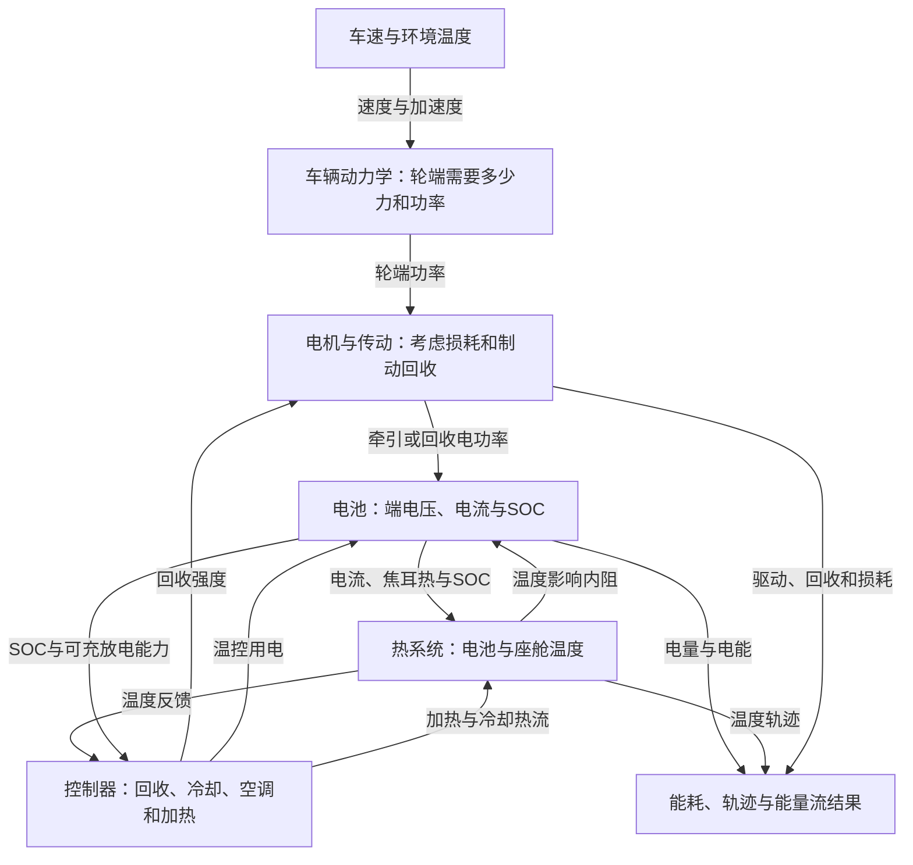

# C题建模原理说明：从通俗理解到可以写进模型的公式

这份说明解释[项目执行方案](C题项目执行方案.md)的数学与物理依据。阅读时可以先看每节“通俗理解”，再看公式。公式中的具体边界和例子是实现建议或教学示例，不是比赛计算结果。

## 1. 先理解整件事：建立一个能做实验的“虚拟电动车”

**通俗理解：** 告诉虚拟车每一秒开多快、外面多冷，它就计算电池用了多少电、还剩多少电、车和电池有多热。然后拿真实行驶记录校准这辆虚拟车，最后在虚拟车里比较不同节能开法。

这里的车速已经由工况给定。主任务是按相同行驶任务计算耗电和控制热管理；节能比较时不能擅自把车开慢或减少行程。



温度影响内阻，内阻影响发热和耗电，冷却可以降温但也要用电。这条反馈链正是本题的核心。

## 2. 四种东西要分清：输入、状态、参数、决策

| 类别 | 本题中的例子 | 通俗理解 |
|---|---|---|
| 输入 | 给定车速、环境温度 | 外界告诉模型的条件 |
| 状态 | SOC、电池温度、座舱温度 | 车现在处于什么情况，下一刻要从这里继续算 |
| 参数 | 空阻系数Cd、滚阻系数Cr、参考内阻Rref、热容 | 这辆车本身的特性 |
| 决策 | 回收比例、冷却开关、空调及加热功率 | 控制器此刻可以怎样操作 |

“参数辨识”是用数据弄清这辆车是什么样；“控制优化”是在这辆车上决定怎样操作。两个阶段不能随意互换，否则可能通过改变车辆参数制造虚假的控制收益。

系统级集中参数模型用少数平均状态描述部件。例如用一个温度代表电池整体，接受不能看见每个电芯局部热点的限制。它适合本题的整车级能量与策略研究。

## 3. 车辆动力学：车为什么需要消耗能量

### 3.1 从速度算加速度

$$
v[\mathrm{m/s}]=\frac{v[\mathrm{km/h}]}{3.6},\qquad a=\frac{\mathrm{d}v}{\mathrm{d}t}.
$$

**通俗理解：** 保持速度要克服阻力；越快地提速，还要额外用力推动整车。附件2每行相隔的时间不一样，必须用真实时间计算变化率。

实测速度有量化和噪声，直接相邻差分会产生虚假的大加速度。实现时可在每条路程内部按真实时间进行局部多项式平滑求导，并检查平滑窗口对功率和辨识的影响；停车和明显制动不能被平滑掉。

### 3.2 四项主要力

平路主模型可写为：

$$
F_{\mathrm{tr}}=\delta ma+mgC_r+\tfrac12\rho C_dAv^2.
$$

若有可靠坡度信息，增加$mg\sin\alpha$，滚阻改为$mgC_r\cos\alpha$。没有坡度数据时，平路是需要说明的假设，真实道路误差中应保留坡度的影响。

| 项 | 物理含义 | 通俗解释 |
|---|---|---|
| δma | 等效惯性力 | 给整车和旋转部件加速需要的力 |
| mgCr | 滚动阻力 | 轮胎与路面接触、变形产生的阻力 |
| ρCdAv²/2 | 空气阻力 | 车向前推动空气，速度越高越明显 |
| mg sinα | 坡度阻力 | 上坡抬高车辆的势能，下坡可能释放势能 |

在前进速度大于零时使用上述路阻方向；停车时不应把滚阻常数误当成持续产生机械功的来源。

轮端功率为：

$$
P_w=F_{\mathrm{tr}}v.
$$

功率单位是W。正功率表示动力系统向车轮供能；负功率表示需要制动，部分可回收，剩余由摩擦制动消耗。

**教学例子：** 用附件参考的1600kg、δ=1.05、Cr=0.01、Cd=0.28、A=2.3m²、ρ=1.2kg/m³，假设平路以20m/s、1m/s²加速，轮端需求约39.8kW。这只演示公式用法，不是CLTC仿真结果。

## 4. 电机与制动回收：车轮和电池之间会损失多少

### 4.1 驱动与回收分开处理

驱动时的简化功率关系：

$$
P_{\mathrm{tr,dc}}=\frac{P_w}{\eta_g\eta_m\eta_{inv}},\qquad P_w>0.
$$

回收时先决定轮端回收功率：

$$
0\le P_{\mathrm{reg,w}}\le -P_w,\qquad
P_{\mathrm{reg,w}}\le\beta(-P_w),\qquad 0\le\beta\le1,
$$

并按电机、电池、SOC和温度能力进一步限幅，再算：

$$
P_{\mathrm{tr,dc}}=-\eta_g\eta_{m,gen}\eta_{inv}P_{\mathrm{reg,w}},\qquad P_w<0.
$$

未回收的轮端制动功率：

$$
P_{\mathrm{fric}}=(-P_w)-P_{\mathrm{reg,w}}\ge0.
$$

**通俗理解：** 电池供100份能量，到车轮只剩一部分；制动时车轮释放100份机械能，电池也只能收回一部分。不能正反两个方向都除以效率，否则会凭空多出能量。

电机回收的电能还可能先供应空调和附件，因此“电机发出了多少电”与“电池最终净充入多少电”并不相同。

### 4.2 附件给的效率图怎样用

由传动比i和轮半径r求电机转速：

$$
\omega_m=\frac{iv}{r}.
$$

通过转矩和转速查效率MAP或计算损耗。驱动时可由轮端力直接计算转矩，避免停车附近除以零。附件MAP的转速自变量按r/min读取，损耗公式中的角速度按rad/s读取，两者用$\omega=2\pi n/60$转换。

附件提供损耗模型：

$$
P_{loss}=300+0.222T_m^2+0.004\omega_m^2.
$$

采用此式后，电机输入与输出的差已经是损耗；不能再使用含相同损耗的效率又扣一次。零转速效率可能无定义，应直接使用功率/损耗与工作状态逻辑。驻车电耗单列，不能由一个无条件损耗常数随意决定。

电机150kW、310N·m和16000r/min限制需同时检查；峰值功率与峰值转矩不是所有转速都能同时达到。按给定速度算出超出能力的需求时应报告不可行。

## 5. 电池电模型：怎样从用电功率算出SOC

### 5.1 电池端需要供多少功率

$$
P_b=P_{\mathrm{tr,dc}}+P_{lv}+P_{ac}+P_h+P_{cool}.
$$

**通俗理解：** 电池既要推动车，也要供应空调、加热、冷却和其他电器。即使车停着，电池也可能继续耗电。

统一采用放电电流为正、充电为负。附件数据的电流符号需要转换并验证，不能直接套入相反约定的方程。

### 5.2 Rint模型

$$
U=U_{oc}(z)-IR(z,\theta_b),\qquad P_b=UI.
$$

- $U_{oc}$：开路电压，可理解为“不带负载时的电压”。
- $IR$：负载使端电压产生的压降。
- R：等效内阻，它也决定发热。

附件OCV曲线是单体数据，包级电压按串联数转换。附件给出了96串信息，应统一使用对应尺度；不能把单体约3—4V直接用于整包约数百伏的功率计算。

如果Rref定义为25℃、SOC=0.5时的内阻，建议把SOC修正归一化：

$$
R(z,\theta_b)=R_{ref}\frac{\kappa_z(z)}{\kappa_z(0.5)}\kappa_T(\theta_b),\qquad \kappa_T(25)=1.
$$

原因是附件SOC=0.5修正值并非恰为1；不归一化时，Rref的物理含义会发生变化。温度修正与插值在给定范围内使用，超出范围需说明处理和不确定性。

### 5.3 给定功率求电流

由上两式得：

$$
RI^2-U_{oc}I+P_b=0.
$$

选取正常工作分支，可用数值上较稳定的形式：

$$
I=\frac{2P_b}{U_{oc}+\sqrt{U_{oc}^2-4RP_b}}.
$$

R接近零时退化为$I=P_b/U_{oc}$。如果判别式小于零，当前模型无法提供该功率；还应检查电流、电压和充放电能力等边界。不能把负判别式截成零后假装正常完成了给定工况。

### 5.4 SOC更新

主线先采用库仑效率近似1：

$$
\frac{\mathrm{d}z}{\mathrm{d}t}=-\frac{I}{3600Q_{Ah}},\qquad
z_{k+1}=z_k-\frac{I_k\Delta t_k}{3600Q_{Ah}}.
$$

有可靠来源再区分充放电效率，并在所有模型中统一。

**通俗理解：** SOC是电荷的库存。每一秒把流出的电流累加，就知道库存减少了多少。式中的3600来自1小时等于3600秒。

**教学例子：** 假设容量160Ah，以100A放电60秒，SOC下降约1.04个百分点；80%约变为78.96%。这里“下降1.04个百分点”与“下降1.04%相对比例”要区分。

## 6. 电池热模型：为什么用电会让电池发热

### 6.1 热量收支

$$
C_b\frac{\mathrm{d}\theta_b}{\mathrm{d}t}
=I^2R+\dot Q_{rev}-H_b(\theta_b-\theta_a)-\dot Q_{cool}+\dot Q_{heat,b}.
$$

| 项 | 含义 | 通俗解释 |
|---|---|---|
| Cb | 电池包热容，J/K | 温度升高1℃要存入多少热量 |
| I²R | 焦耳热，W | 电流流过内阻造成的不可逆发热 |
| Qrev | 可逆熵热，W | 电化学反应还会吸热或放热，符号依约定 |
| Hb(θb−θa) | 与环境的换热 | 电池比环境热就散热；比环境冷可能吸热 |
| Qcool | 主动移走的热量 | 冷却系统带走的热 |
| Qheat,b | 主动电池加热 | 主线未设电池加热时取0，不能把座舱加热器自动视为电池加热器 |

**通俗理解：** “温度变化＝存进去的热−散出去的热，再除以热容”。热容大的物体升温慢。

按本说明“放电为正”的约定，一种一致的可逆热写法为：

$$
\dot Q_{rev}=-IT_{b,K}\frac{\partial U_{oc}}{\partial T},\qquad T_{b,K}=\theta_b+273.15.
$$

附件公式示意中的电流方向可能与模型不同，加入熵热时必须连同电流符号、包级/单体级系数一起核对。先用焦耳热跑通，再做含熵热的对照更容易排错；不能为了让温度上升而任意改符号。

**教学例子：** Uoc=375V、I=100A、R=0.1Ω时，端电压365V，端口输出36.5kW，内阻热1kW，电气端口的37.5kW可逆电功率分为这两项。若只保留这1kW焦耳热，完全不散热，Cb=3.2×10⁵J/K，60秒升温约0.1875℃。这不是完整工况预测。

### 6.2 冷却不是免费的

使用附件换热形式的原型：

$$
\dot Q_{cool}=u_{cool}K_{cool}\max(\theta_b-\theta_{ch},0),\qquad
P_{cool}=\frac{\dot Q_{cool}}{COP_b}.
$$

还需按实际拓扑限制制冷功率；若另计水泵电耗，应有来源，并在所有策略中一致。附件参考值为$K_{cool}=60$W/K、冷却液25℃。当电池比冷却液冷时，该式不产生主动制冷，不能出现“负制冷”偷偷加热的效果。

**通俗理解：** 冷却可以少发热、降低内阻，但冷却机本身也花电。优化要比较“省下来的损耗”与“额外冷却电耗”，所以一直开冷却不一定最省电。

COP=2.5表示消耗400W电功率，在所用简化模型下可以搬走约1000W热量；搬走的热量不能再作为额外1000W电负载加入电池账本。

## 7. 座舱热模型：为什么不能靠关闭空调轻易宣布节能

$$
C_c\frac{\mathrm{d}\theta_c}{\mathrm{d}t}
=H_c(\theta_a-\theta_c)+\dot Q_{solar}+\dot Q_{person}
+\eta_hP_h-COP_cP_{ac}.
$$

**通俗理解：** 车厢像一个会漏热的小房间。外面热、太阳晒、人坐在里面都会带来热；加热器送热，空调搬走热。关掉空调确实少用电，但如果乘客很难受，就不是相同服务水平下的节能。

附件给驾驶室热容、漏热系数、乘员和太阳参考热量。太阳项应与场景匹配，例如参考“夏季正午”不能无条件套到低温夜间。空调和PTC分别受到附件功率上限约束。

舒适温区、允许偏差及初始恢复过程是需要自己说明依据的假设。若冷天座舱初始温度等于环境，不可能一开始就满足室内舒适温度下限，必须先检验加热上限下的可达性，再统一设置升温阶段或偏差预算。

## 8. 能耗与能量分解：怎样避免一份电重复记两次

### 8.1 功率积分为能量

$$
E_b[\mathrm{kWh}]=\frac{1}{3.6\times10^6}\int P_b[\mathrm W]\mathrm{d}t[\mathrm s],
\qquad D[\mathrm{km}]=\frac1{1000}\int v[\mathrm{m/s}]\mathrm{d}t.
$$

$$
e_{100}=100\frac{E_b}{D}.
$$

离散数据建议用相邻时刻的梯形积分，严格使用各段真实时间差。回收按负电池端功率参与净积分；另外报告总放电和总充入，说明它们的差等于净耗电。

### 8.2 分层做能量账本

DC母线这一层可以核对：

$$
E_{b,net}=E_{tr,dc}^{+}-E_{reg,dc}+E_{lv}+E_{ac}+E_h+E_{cool}.
$$

这里$E_{reg,dc}$指电机回到母线的能量，未必等于电池净充入量。$E_{tr,dc}^{+}$内部再分为轮端输出和电机、逆变器、传动损耗，不能把这两层全部并列相加。

电池电气端口还满足瞬时恒等式：

$$
U_{oc}I=UI+I^2R.
$$

这说明内阻损耗位于电池内部；不能在“已经按电池可逆电功率计算的能量”之外又重复添加一次。热系统的熵热、换热和储热另核其热平衡，不混入DC用电支路。

**通俗理解：** 你给一家店付了100元，店家用其中80元进货、20元付房租。总支出仍是100元，不能写成100＋80＋20＝200元。驱动电能与驱动内部损耗也有这种包含关系。

能量占比必须写分母。存在回收支路时，优先画有方向的能量流图，并同时列出数值账本；不要强行把所有带正负的支路塞成“全部正数且合计100%”的饼图。

## 9. 灵敏度分析：先找出最影响结果的“旋钮”

**通俗理解：** 分别把车辆参数轻轻调大、调小，看看结果变多少，就知道哪个参数最值得准确测量、哪个环节值得优化。

以百公里能耗Y为例，参数pi的中心差分标准化灵敏度为：

$$
S_i\approx\frac{Y(p_i(1+\varepsilon))-Y(p_i(1-\varepsilon))}{2\varepsilon Y_0}.
$$

其他条件保持不变。$\varepsilon$可从0.1开始，再检查0.05或0.2的结果是否改变结论；这些是分析设置，不是官方数值。按$|S_i|$排序，同时保留正负号解释作用方向。

建议选Cd、Cr、Rref、整车质量、低压附件功率、COP和电池热容七项。电池热容对短时温升可能重要，对某场景的电耗却不明显，两个指标应分别排名。

温度用“改变了多少K/℃温差”或以固定、说明过的温升尺度归一化，不直接除以摄氏温度求百分比；能量、SOC和温度的灵敏度不宜混成一个无单位说明的总排名。开关控制附近可能非光滑，应同时画扰动曲线。

## 10. 参数辨识：怎样让虚拟车更像记录中的真实车

### 10.1 正向问题和反向问题

**通俗理解：** 已知车重、路阻和电池参数，算会用多少电，叫正向仿真；已经有真实用电记录，反过来寻找能解释记录的参数，叫参数辨识。

指定待估向量：

$$
\boldsymbol p=[C_d,C_r,R_{ref}]^\mathsf T.
$$

第一问搭好“计算器”，第二问反复调整其参数，让它的预测与数据更接近。优化器只是寻找参数的工具，物理模型及数据是否支持参数才决定结果可信度。

### 10.2 辨识目标怎样写

一个可实现的联合目标示意为：

$$
J(\boldsymbol p)=\sum_{j\in\mathcal T}\left[
\frac{w_z}{n_j}\sum_k\left(\frac{\hat z_{jk}-z_{jk}}{s_z}\right)^2
+\frac{w_U}{n_j}\sum_k\left(\frac{\hat U_{jk}-U_{jk}}{s_U}\right)^2
+w_E\left(\frac{\hat E_j-E_j}{s_E}\right)^2
\right].
$$

其中$\mathcal T$是训练路程，帽子表示预测，$s_z,s_U,s_E$是声明的尺度，w是权重。实际可按噪声采用稳健损失，并在验证集选择配置。若已用电能残差，又加入来自同一电压/电流的高密度功率残差，要防止相关信息被重复赋予过高权重。

**通俗理解：** 同时比较剩余电量、电压和总电耗，但不能因为电压的数字比SOC大，就让优化器只顾电压；也不能因为某段记录更多，就忽视另外一段。

直接用测得I和U估计内阻，可作为初始化或单独的电池模块验证；正式整车预测时，I必须由轮端需求、附件负载和电池方程算出。若直接用实测I积分，Cd和Cr根本不参与SOC预测，不能证明三个整车参数都已校准。

### 10.3 四条路程如何分工

建议正式拟合前固定：575和596训练，588验证，600最终测试。训练让模型学参数，验证选择权重和结构，测试检查冻结后能否解释另一段路程。路程600偏低速、低温，属于有意义且可能较困难的检验。

**通俗理解：** 训练相当于做练习题，验证相当于用模拟题挑方法，测试相当于最后的考试。先看考试答案再改方法，考得高也不能证明学会了。

相邻时间点高度相关，所以不能随意把一条路程拆成随机行分到训练和测试。四段数据有限，任何统计结论都应说明样本局限。基础数据质量检查与正式调参要有记录，不能声称此前完全没看过所有测试数据。

### 10.4 RMSE和MAPE到底在说什么

SOC样本均方根误差：

$$
RMSE_z=100\sqrt{\frac1N\sum_k(\hat z_k-z_k)^2}\quad\text{（百分点）}.
$$

z使用0—1。如果SOC原本已按0—100输入，就不要再乘100。

**通俗理解：** SOC曲线平均偏了多远，较大的偏差会受到更明显惩罚。RMSE为1个百分点，表示误差处于约一个SOC百分点的量级，并非保证每个时刻都差1。

非等间隔数据还可补充时间加权形式：

$$
RMSE_{z,t}=100\sqrt{\frac{\int(\hat z-z)^2\mathrm dt}{t_f-t_0}}.
$$

以m条路程净电能为对象：

$$
MAPE_E=\frac{100}{m}\sum_{j=1}^m\left|\frac{\hat E_j-E_j}{E_j}\right|.
$$

**通俗理解：** 一段实测用了2kWh，预测2.2kWh，这一段相差10%。它衡量相对误差。不要对频繁过零的瞬时功率直接计算MAPE，分母接近零会导致指标失真。只有一条测试路程时，MAPE数值等于该路程绝对百分比误差，应写清统计对象。

### 10.5 电荷与SOC的矛盾为什么要先查

粗略等效容量诊断为：

$$
Q_{eff,j}\approx\frac{\int I_{dis,j}\mathrm dt/3600}{z_{j,0}-z_{j,f}}.
$$

这里用转换后的放电为正的净电流，包含回收符号。根据原时间轴梯形积分得到的探索性结果如下：

| 路程 | 净放电量约Ah | SOC下降约百分点 | 粗略等效容量约Ah |
|---|---:|---:|---:|
| 575 | 5.621 | 12.317 | 45.63 |
| 588 | 3.474 | 10.488 | 33.12 |
| 596 | 7.182 | 10.488 | 68.48 |
| 600 | 2.791 | 8.415 | 33.17 |

这些量不是已辨识的电池真实容量。时间错位、缺口、测量口径、SOC滤波/量化、温度或车辆差异都可能影响它。现有证据只能说明，不能不经检查地认为固定参考容量与所有记录完全一致。

应先排查，再决定是否需要一个仅用训练数据估计的共享有效容量；所有参考/校准/控制版本都写明该处理。不能给测试路程单独拟合容量或用它的SOC终点修正预测，否则会隐藏失配并泄漏答案。

## 11. 可辨识性与置信区间：拟合得好不等于参数就是真的

### 11.1 为什么空阻和滚阻可能分不清

平路牵引功率中的两项近似为：

$$
P_{roll}=mgC_rv,\qquad P_{aero}=\tfrac12\rho C_dAv^3.
$$

**通俗理解：** 滚阻像持续的小拖拽，空阻在高速时迅速变大。只给低速或速度变化很小的记录，两种阻力对耗电的影响很难分别看清。可能把Cd调大、Cr调小，曲线仍差不多。

可检查标准化灵敏度矩阵、参数相关性、不同速度段估计、多初值结果和参数剖面。某参数变化很大而目标几乎不变，说明现有数据对它的约束弱。

内阻还会和参考OCV、容量、未知电池初温互相影响；只靠SOC误差通常不足以说明内阻估计可靠，因此需要电压和功率信息，并承认参考曲线的不确定性。

### 11.2 置信区间怎样来

**通俗理解：** 参数估计不应只写一个“看似很准的数字”，还要说明数据允许它大致在哪个范围变化。区间宽意味着信息不足，并不意味着模型一定做错。

可用两种互相检查的办法：

1. **剖面方法：** 固定一个参数在不同值，重新优化其余参数，观察拟合变坏多少；在明确的误差模型下构造区间。若曲线很平、非对称或边界内不闭合，如实报告。
2. **块残差自助法：** 在原输入与时间轴不变的前提下，按连续时间块联合重采样拟合残差，重构观测并重新估计，取得参数分布及区间。块长与重复次数做稳定性检查，不将原始行驶片段拼成假连续路程。

四段路程很少，误差还可能非平稳，区间是基于方法和噪声假设的条件性结论；不要因高频记录有几千行就声称有几千个独立实验。需声明置信水平及边界处理；优化器允许的取值范围不是统计置信区间。

## 12. 节能控制：怎样同时考虑电费、温度和舒适性

### 12.1 定义可控量与不可动的条件

控制向量可以写为：

$$
u_k=[\beta_k,u_{cool,k},P_{ac,k},P_{h,k}].
$$

车速工况、硬件参数、初始SOC、温控服务要求等是对照条件。回收比例不能凭空增加可用制动能；SOC高或温度低时可能限制充电，需要摩擦制动补足相同的减速度需求。

优化目标可示意为：

$$
\min_u\; \sum_k\left[P_{b,k}\Delta t_k+\lambda_c d_c(\theta_{c,k})^2\Delta t_k
+\lambda_s|u_{cool,k}-u_{cool,k-1}|+\lambda_u\|\Delta u_k\|^2\right]+V_f(x_N).
$$

各项使用一致能量单位或显式归一化。$d_c$表示舒适偏差，切换项避免频繁启停，终端项$V_f$处理“把热或冷借到终点”的问题。题目主目标仍是能耗；加入权重后须同时单列实际电耗与舒适结果，不能只报一个综合分数。

约束至少考虑：SOC和可充放电能力、电机功率/转矩/转速、制冷与加热能力、电池温度边界、座舱舒适要求、冷却最短启停时间或滞环。数值阈值需来源或假设说明。

### 12.2 三种控制方法的直觉

| 方法 | 通俗理解 | 实际实现 | 最需要说明的边界 |
|---|---|---|---|
| 固定规则 | 温度高了就开冷却，冷了就加热 | 固定阈值、滞环和回收上限 | 是公平且合理的基准，不人为设坏 |
| 优化规则 | 在仿真里试出一套更合理的温控习惯 | 优化少量阈值、目标温度与分段回收系数，之后冻结执行 | 最优只相对所选规则族、工况和搜索范围 |
| 模型预测控制MPC | 边走边看短期趋势，提前安排温控 | 预测一小段→优化→只执行第一个动作→再预测 | 预测信息、求解耗时、失败回退与约束 |
| 离线动态规划DP | 预知整段路，按离散网格逐步倒推最优安排 | 状态/动作离散化、Bellman递推、原模型复核 | 是指定离散问题的离线参考；不自动是连续问题下界或可实时方案 |

不必为“智能”而强行训练神经网络。现有数据更适合先完成可解释的参数辨识、优化规则和预测控制，再用实验说明贡献。

### 12.3 MPC为什么只执行第一个动作

**通俗理解：** 你预测接下来一分钟可能有一段高负载，所以稍提前冷却。但预测会变化，走过几秒后重新计算更稳妥。如果一次把一分钟计划全部执行完，就失去了反馈纠偏机会。

程序原型可从5s控制周期、30—60s预测时域起步，仿真内部仍用较细步长。求解器超时或不可行时回到固定安全规则，并统计回退次数。

如果使用整段CLTC未来速度，应标注“已知未来工况”的离线/理想信息实验。主评估应明确采用当前速度保持、短期预测或真实可获取信息。比较算法时要把信息差异和算法差异分开解释。

### 12.4 三种权衡怎样写成证据

| 要讨论的东西 | 含义 | 应给的证据 |
|---|---|---|
| 最优性 | 在约束下是否还可能有更好方案 | 与规则/优化规则/离线参考比较、多初值与参数邻域、网格或窗口检查 |
| 实时性 | 能否在下一次需要动作前算完 | 计算机配置、控制周期、平均/p95/最大耗时和超时次数 |
| 可落地性 | 实际车上能否测到所需状态、执行动作 | 状态来源、预测来源、功率边界、启停限制、备用规则及模型偏差 |

只有仿真验证时，应表述为“具备实现条件的仿真策略”及其局限，而不能声称已经完成实车部署。

## 13. 公平比较：怎样证明节能没有靠降低服务水平

节能率可写为：

$$
Saving=100\frac{E_{base}-E_{opt}}{E_{base}}.
$$

分母接近零时改报能量差。基准和优化必须具有相同车速、环境、初始状态、硬件、舒适/安全要求、统计边界和可比较的信息条件。

**通俗理解：** 两台空调比较省电，应该让同样的房间达到相同舒适程度。把一台设26℃、另一台设18℃，很难只凭电费说哪台算法更好。

热系统还存在“先欠着”的问题：某策略结束时电池更热或座舱偏离舒适目标，可能只是把冷却工作留到下一段。可用相同热终态容差、经过复核的终端项，或重复工况达到稳定后比较。若终态不同，明确报告热储能差，不将单次暂时收益直接说成长期节能。

推荐同时列：净电能、百公里能耗、节能率、SOC终值、电池温度范围、座舱舒适偏差、越界幅度/时间、平均/p95/最大耗时、备用控制触发率。

## 14. 模型怎样被验证：四层证据各自回答不同问题

| 层级 | 做法 | 证明范围 |
|---|---|---|
| 物理检查 | 匀速/停车/制动、能量与热平衡、回收上界、硬件能力 | 方程实现没有明显违反物理规律 |
| 数值检查 | 步长减半、输入插值和求导窗口对比 | 结果没有主要由数值设置决定 |
| 数据验证 | 冻结参数后预测独立路程的SOC、电压与电能 | 在已有测量条件和数据范围内是否有解释能力 |
| 决策验证 | 同条件基准对比、场景迁移、参数扰动、消融、原模型复算 | 策略在模拟范围内的收益、机制与稳定性 |

这些证据不能互相替代。能量守恒正确不代表参数准确；SOC准确不代表温度准确；同一个仿真器里策略有效也不等于实车已经有效。

可选−10℃、40℃或道路场景用于拓展，但附件没有温度实测且环境数据集中在较低温，外推能力要透明说明。对不确定参数抽样时应尊重相关性，若使用独立极端组合，要标成保守情景而非统计高概率情况。

## 15. 程序每一步到底算什么

下面是计算逻辑示意，实际需使用合适的积分/迭代方法，而不只是把所有状态粗略向前加一次。

```text
读取并转换速度、时间、环境温度，载入参数及初始状态
对每个仿真时间步：
    1. 根据工况速度和加速度计算轮端需求
    2. 控制器根据当前状态和允许的预测信息给出回收/温控动作
    3. 根据电机、传动和回收边界计算DC侧牵引功率
    4. 加上空调、加热、冷却和附件电耗，得到电池端功率
    5. 用OCV、内阻和功率求电流、端电压，检查供电与充电能力
    6. 积分更新SOC和电池/座舱温度
    7. 记录功率、能量、状态、约束、计算耗时和失败情况
按真实时间积分，输出指标、图表与视频数据
```

温控功率与热流互相依赖时，需选明确的顺序、子步或代数迭代，并通过步长收敛确认误差可接受。若MPC用较简化预测模型，最终动作必须放回统一机理模型复算。

## 16. 推荐软件和学习顺序

推荐Python作为主工具，原因是当前环境已具备核心科学计算库，数据清洗、仿真、辨识和图表可以共享一个工程。

| 工具 | 本项目用途 |
|---|---|
| Pandas、OpenPyXL | 读取Excel、按路程分组、数据字典与清洗 |
| NumPy | 数组、插值、积分与状态计算 |
| SciPy | 有边界参数估计、非线性优化、微分方程积分 |
| Matplotlib | 论文静态图、轨迹动画、能量流可视化 |
| FFmpeg或经过验证的MP4编码工具 | 将动态帧与讲解导出为提交视频；当前PATH尚未发现FFmpeg |
| Markdown/Word/LaTeX任选熟悉者 | 组织论文，最终导出符合格式规范的PDF |

MATLAB/Simulink也可以实现同样模型；团队已有熟练经验时可替换。当前不需要为了软件数量增加跨工具接口。先学会读取一条路程、画曲线、写一个状态更新，再逐步加入辨识和优化。

## 17. 建模中需要始终保留的区分

- **参考值与真值：** 附件给参考值，不等于已验证实车值；冲突与适用范围需要核对。
- **电池容量与电池能量：** Ah表示电荷容量，kWh表示能量；容量乘电压只能近似换算，实际随电压轨迹变化。
- **电功率与热功率：** COP把两者联系起来，不能混加。
- **SOC预测与SOC读取：** 初值可读取，此后的整车预测应从模型算出。
- **拟合改善与参数可靠：** 多组参数可能拟合同样好，区间和可辨识性必须另看。
- **仿真验证与实车验证：** 本题可完成扎实的仿真实验，证据范围要写清。
- **计划目标与实际结果：** 应先定义实验，再记录真实结果；不提前写“误差必降多少、节能必达多少”。

本题最值得先掌握的关系是：**速度决定动力需求，动力与附件共同决定电流，电流改变SOC并产生热，温度影响内阻与控制，而控制又改变电耗和温度。** 三问沿着这同一条链，依次完成计算、校准和决策。
