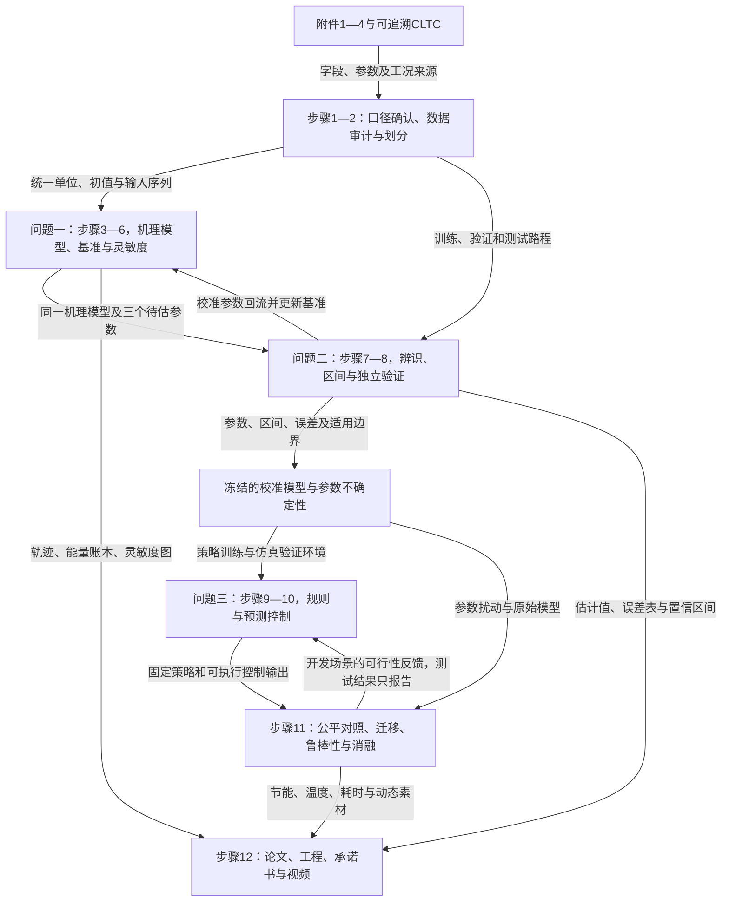

# C题项目执行方案：按评分要求组织的12步实施路线

适用赛题：2026年第二届全国大学生仿真建模应用挑战赛C题“新能源汽车能量流与热管理系统仿真”。本方案依据随题原文、四份Excel、提交流程、论文格式规范和AI工具使用规定制定。方法、软件、参数边界及验收阈值属于实施建议，不是官方指定方法；初稿制定时尚未执行计算，以下保留路线设计，实际完成情况以[开发日志](../C题开发日志.md)和[阶段四结果](../results/阶段四进展.md)为准。

配套阅读：[精简版](C题项目执行方案_精简版.md)、[建模原理与通俗解释](C题建模原理说明.md)、[赛题逐项核对](C题-题意逐句翻译.md)。

## 1. 整题建模主线

### 1.1 最终要做成什么

完成一套可以重复运行的电动车系统仿真：给定车速和环境温度，输出电池耗电、剩余电量、温度变化及能量去向；利用四段实测行驶记录辨识参数；让同一套仿真成为节能控制策略的验证环境。论文、工程和视频共享同一批计算结果。

推荐主线为：**纵向动力学 + 电机效率/损耗关系 + Rint电池模型 + 电池/座舱双热节点 + 有约束参数辨识 + 规则基准与预测控制对比**。

“双热节点”指用一个平均温度描述电池、另一个平均温度描述座舱。Rint指开路电压加内阻的等效电路。这些模型与附件数据对应，计算量适合多次校准和控制优化。预测控制可按时间条件降为经优化的温控规则，见第5节。

### 1.2 将分数落实为证据

| 评分维度 | 分值（总分100分） | 必须准备的证据 | 主要步骤 |
|---|---:|---|---|
| 系统建模与物理正确性 | 20 | 耦合方程、参数来源、边界条件、守恒检查、数值收敛和硬件可行性 | 1—5 |
| 数据驱动校准的科学性 | 15 | 数据划分、三参数估计、校准前后RMSE/MAPE、置信区间及可辨识性 | 2、7—8 |
| 双向赋能的深度 | 10 | 实测数据校准模型；校准模型训练或验证控制器的实际流程与结果 | 7—11 |
| 优化决策的质量 | 10 | 同条件基准对比、节能与温控效果、求解耗时、可执行控制逻辑 | 9—11 |
| 创新性 | 10 | 针对性改进、消融对比、跨场景与参数不确定性实验 | 10—11 |
| 规范性与可复现性 | 5 | 统一符号单位、规范引用、运行说明、结果追溯和匿名材料 | 全程、12 |
| 视频完整性与科学性 | 10 | 模型、校准、仿真结果、优化对比四环节齐全 | 5起留素材，12完成 |
| 视频可视化与技术实现 | 10 | 动态能量流、SOC/温度/功率轨迹、单位与坐标齐全 | 5、12 |
| 视频结构与叙事 | 5 | 问题—方法—结果—结论，讲解与画面对应 | 12 |
| 视频规范与一致性 | 5 | 3分钟内、清晰、音画同步，与论文数值一致 | 12 |

### 1.3 范围与优先级

**必做**：场景A（25℃、CLTC）；三问完整；至少5参数灵敏度及排序；三个指定参数辨识；前后SOC RMSE及能耗MAPE；至少2参数置信区间；可辨识性；回收/冷却/空调加热决策及三方面权衡；可运行工程和视频。

**推荐加分**：独立路程测试；40℃或−10℃场景至少选一个；参数不确定性传播；规则与预测控制对比；一个能解释机制的消融实验。

**有余力再做**：第二种极端温度、离线动态规划参考、老化代价、数据残差修正。附件4虽有老化关系，题目没有强制要求将老化作为优化目标。

## 2. 跨问题联动链



控制器只能利用选定的信息；使用整段未来车速的离线方法与只能看到当前/短期预测的在线方法应分别标注。最终测试路程和最终迁移场景的结果不用于反复改策略。

## 3. 全文统一建模口径

### 3.1 统一变量与接口

| 项目 | 符号与单位 | 统一规则 | 使用问题 |
|---|---|---|---|
| 时间、车速、加速度 | t：s；v：m/s；a：m/s² | 原始毫秒除1000，km/h除3.6；非等间隔按真实时间处理 | 全部 |
| SOC | z：0—1 | 内部使用比例，图中可转为%；RMSE按百分点报告并声明 | 全部 |
| 温度 | θb、θc、θa：℃ | 换热用温差；熵热或Arrhenius公式用K | 全部 |
| 电流与端电压 | I：A；U：V | 模型统一放电为正、充电为负；原始电流转换需记录 | 全部 |
| 功率与能量 | P：W；E：kWh | 电池端净输出功率为正；积分除3.6×10⁶得到kWh | 全部 |
| 待辨识参数 | Cd、Cr、Rref | 分别为空阻、滚阻、参考内阻；同一版本在三问共用 | 全部 |
| 控制量 | β、ucool、Pac、Ph | 回收比例、冷却状态、空调电功率、加热电功率；电功率与热功率区分 | 一、三 |
| 初始状态 | z0、θb0、θc0 | 基准可先设z0=0.8、温度等于环境，属于新增假设；实测路程采用首个SOC，温度初值另作不确定性 | 全部 |
| 路程能耗 | e100 | 净电池端电能/行程公里数×100；同时报告总放电与总回收 | 全部 |
| 误差 | RMSEz、MAPEE | SOC在同一时刻比较；MAPE以整段净耗电或明确的正净能量窗口为统计对象 | 二 |
| 约束 | 温度、SOC、功率与回收边界 | 由附件硬件和有依据的新增工程假设确定；同场景同约束比较 | 三 |

统一调用接口建议为`simulate(cycle, parameters, initial_state, controller)`，输出相同的时间序列表与能量账本。问题一采用参考参数，问题二更新参数，问题三更换控制器；不复制三套不同物理方程。

### 3.2 必须先处理的歧义与数据风险

| 问题 | 已知事实 | 执行处理 | 禁止出现的做法 |
|---|---|---|---|
| 标称能量与容量冲突 | 附件1写30kWh、160Ah、375V；乘积约60kWh；用户暂未收到勘误 | 保留原始值与疑点；如无勘误，主参考模型可优先保留显式Ah容量，另以30kWh/375V≈80Ah作对照；标称乘积只作近似，最终能量由OCV与电荷积分核算；选择理由写入论文 | 将30kWh和160Ah同时作为完全一致的电池约束，或宣称某项已被官方更正 |
| 实测SOC与电流不完全一致 | 按原时间及放电电流粗积分，四段等效容量约45.63、33.12、68.48、33.17Ah | 先排查时间对齐、符号、SOC量化、缺口和电流测量口径；这组量仅是诊断；若仍不一致，比较固定参考容量与训练集估计的共享有效容量，保持最终模型版本一致 | 将每条测试路程的真实SOC终点拿来反推容量，再称独立预测准确 |
| CLTC身份 | 附件3标题仅“参考工况”，0—1800s、最高114km/h、积分约14.4667km | 核对可追溯CLTC序列；未确认时附件3保留为场景E，不自行改名；取得的标准序列记录来源 | 仅因时长1800s或最高速度接近，就断定是CLTC |
| 数据温度范围 | 实测环境约−6.5至8.5℃，无电池/座舱温度列 | 电压、电流、SOC与电能可对照；温度做物理检查、文献范围与参数扰动；25℃和极端场景属于外推检验 | 声称温度预测已由附件2直接验证 |
| 参考部件并非实车标定曲线 | OCV、电机效率等在附件标为参考 | 检查OCV残差与功率残差；必要时增加少量、有界的训练集干扰参数，并报告其物理含义和影响 | 无限增加补偿参数把任何数据拟合到零误差 |
| 路坡未知 | 附件2没有坡度列 | 主线可假设平均平路；将道路坡度/未知风等作为误差来源，对残差和参数偏差讨论；有可靠地理数据才扩展 | 把道路未知坡度造成的功率变化全部解释为空阻系数变化 |

有效容量若确需估计，属于额外干扰参数，不能替代题目指定的Cd、Cr、Rref辨识。可先从训练路程电荷—SOC关系估计并冻结，再完成三参数辨识；置信区间计算应考虑前序估计的不确定性。若单一共享容量仍解释不了四段数据，应报告模型失配并给分路程误差。

## 4. 分问题求解思路

### 4.1 问题一：基础建模与基准仿真

#### 4.1.1 问题概述

- 任务：给定工况与环境，求能耗、SOC、温度和能量分布，分析至少5个参数。
- 已知：附件1车辆参考参数、附件4部件关系、场景A温度和CLTC要求。
- 输出：完整基准轨迹、百公里电耗、能量分解、灵敏度排序。
- 数学本质：输入驱动的非线性电—热动力系统；车速已给定，可逆推轮端功率，再求电池状态与温度演化。
- 新增假设：初始SOC、初始温度、道路坡度、温控基准和热管理拓扑须单列，不能混写成题目条件。

#### 4.1.2 总体求解思路

将速度转换为加速度和轮端功率，结合传动、电机和逆变器得到电池端需求功率；求电流及SOC，依据焦耳热、可选熵热和换热更新温度；温度再反馈内阻和控制。采用统一功率账本积分，完成25℃基准和扰动实验。模型结构与参数定义交给问题二，原始基准策略交给问题三作对照。

#### 4.1.3 可用模型及选型比较

| 可行模型/思路 | 模型本质与核心变量 | 完整实现步骤 | 所需数据与假设 | 优点 | 局限与失败风险 | 验证方法 | 与前后问题的接口 | 适用场景 |
|---|---|---|---|---|---|---|---|---|
| Rint电池＋双热节点机理模型 | z、θb、θc；开路电压与内阻；平均温度 | 逆推轮端功率→损耗映射→电流→SOC/热方程→守恒检查 | 主要来自附件；温控、初值及容量冲突需说明 | 状态少，易校准、易优化、能解释能量流 | 不能充分表示电压极化；温度无实测校准依据 | 电能与SOC对照、收支检查、步长减半 | 同一Cd/Cr/Rref供问题二；状态方程供问题三 | 主线推荐 |
| 一阶RC电池＋双热节点机理模型 | 在上一方案加入极化电压状态 | 先建上述模型→加入RC动态→用有激励电流段定参→比较独立路程 | 还需RC参数及初始极化；应有可靠来源或足够激励 | 能描述部分瞬态端电压滞后 | 新参数可能不可辨识；拟合更好未必改善控制 | 相同数据下电压/SOC误差、参数稳定性与耗时 | 保留热与控制接口，替换电池模块 | Rint残差有明确动态结构且时间允许 |

推荐模型：Rint＋双热节点。选用理由：对应现有参考关系、满足机理模型要求，利于重复估计和控制，且不依赖没有提供的实测温度。备选模型：在独立验证证明RC动态有必要时加入。多模型对比：保持相同容量口径、数据划分、初值和温控策略，同时比较测试误差与计算量。

#### 4.1.4 创新与改进方向

| 创新或改进方向 | 基础方案 | 具体改动与实现步骤 | 预期改进 | 新增工作量 | 验证指标与对照实验 | 风险及备用方案 | 影响的问题 |
|---|---|---|---|---|---|---|---|
| 电—热耦合的机制对照 | 内阻固定 | 加入附件SOC/温度修正；与固定内阻模型在同场景比较 | 解释低温损耗和热反馈，不预设误差必然下降 | 低至中 | 能耗、峰值温度、低温误差；关闭修正的消融 | 参考修正不适合实车时报告失配，保留固定参考对照 | 一至三 |
| 能量账本与热终态联合审计 | 只看净电耗 | 同时记录各功率支路、摩擦制动、热储能与终态 | 降低重复记账和借用热储能造成的虚假节能 | 中 | 收支残差、热终态及重复循环结果 | 边界不清时先做DC母线和轮端两个局部账本 | 一、三 |

### 4.2 问题二：数据驱动校准与参数辨识

#### 4.2.1 问题概述

- 任务：利用实测路程估计Cd、Cr、Rref，检查拟合改善及参数可信度。
- 已知：问题一模型；附件2的车速、环境温度、空调/加热、电流、电压及SOC。
- 输出：三个参数估计、前后SOC RMSE与能耗MAPE、至少两个置信区间、可辨识性结论。
- 数学本质：带约束的非线性反问题；需防止相关参数互相补偿和时序数据泄漏。

#### 4.2.2 总体求解思路

先固定路程划分、容量和符号处理，检查电荷与能量一致性；用电压—电流关系形成Rref初值，用速度—功率变化形成Cd/Cr初值，再用统一正向仿真联合估计。训练用于拟合，验证用于选择权重/模型，测试用于最终报告。校准结果回流更新基准仿真，并为问题三提供固定参数及不确定性样本。

特别区分两类计算：测得I、U可用于初始化和校准残差；最终SOC及能耗预测必须由车速、环境和指定的附件负载输入驱动，只使用首个实测SOC作为初值，不能每步读实测电流或SOC再宣称整车模型预测准确。电池模块单独用测量电流验证可作为另一项模块实验明确标注。

#### 4.2.3 可用模型及选型比较

| 可行模型/思路 | 模型本质与核心变量 | 完整实现步骤 | 所需数据与假设 | 优点 | 局限与失败风险 | 验证方法 | 与前后问题的接口 | 适用场景 |
|---|---|---|---|---|---|---|---|---|
| 分阶段辨识后整体校验 | 电压方程估内阻，再用动力功率方程估Cd/Cr | 清洗→估电池参数→选低/中/高速驱动段估路阻→完整仿真检查 | I/U/速度与附件效率关系；阶段误差需传播 | 易调试，可看出哪部分失配 | 前阶段偏差会传给后阶段；不宜只报分阶段局部误差 | 独立路程整车正向预测及阶段残差 | 复用问题一方程；参数交问题三 | 初始化和稳健备用 |
| 多输出约束联合辨识 | 同一参数向量同时解释SOC、电压、功率与能量 | 设物理边界→残差标准化→多初值优化→验证选权重→测试冻结→区间分析 | 同上；需明确缺失温度、容量与OCV误差处理 | 参数和整体目标一致，可同时观察补偿关系 | 对权重敏感；SOC与能量残差相关，不可当独立证据简单叠加 | 未见路程、参数相关性、剖面或块残差自助法 | 输出一致的校准模型与不确定性 | 主线推荐 |

推荐模型：分阶段提供初值，联合辨识得到最终三参数。选用理由：兼顾可解释性、整体前向精度与后续控制一致性。备选模型：联合目标严重不稳定时采用分阶段方案并保留总体误差和区间。多模型对比：同一冻结的数据与容量口径，比较测试误差、参数可解释性、区间宽度和计算成本，不以训练误差决定胜负。

#### 4.2.4 创新与改进方向

| 创新或改进方向 | 基础方案 | 具体改动与实现步骤 | 预期改进 | 新增工作量 | 验证指标与对照实验 | 风险及备用方案 | 影响的问题 |
|---|---|---|---|---|---|---|---|
| 保留时序相关性的区间估计 | 独立同分布残差近似 | 在原输入序列上对多通道残差按连续时间块联合抽样并重新拟合，检查不同块长 | 避免把高频相邻点当作大量独立证据 | 中 | 区间端点稳定性、不同块长和剖面结果对照 | 仅四路程，区间仍是条件性近似；不够稳定则扩大并明确局限 | 二、三 |
| 校准不确定性传入控制 | 只用单一最优参数 | 取有效区间内、尊重参数相关性的代表组合，重复验证固定控制器 | 检查节能是否依赖偶然参数取值 | 中 | 节能分布、最坏温度、约束违反率 | 区间不可靠则只做标明范围的情景扰动，不称统计置信保证 | 二、三 |

### 4.3 问题三：能量流与热管理智能优化

#### 4.3.1 问题概述

- 任务：决定如何回收制动能、何时冷却、怎样使用空调与加热。
- 已知：校准模型、物理边界、工况和基准策略；温区与信息可用性需另行设定。
- 输出：具体可执行策略、能耗与温控效果、计算耗时和适用条件。
- 数学本质：有状态记忆、离散启停及连续功率的约束动态优化；当前温度会影响后续内阻、舒适性与能耗。

#### 4.3.2 总体求解思路

先实现合法的固定阈值基准，再优化规则参数，随后视进度加入短时域滚动预测控制。冷却启停可用候选开关序列枚举配合连续功率优化；设置最短启停时间或滞环，防止抖动。所有候选动作在原机理模型中重新计算温度、能量与硬件边界。校准仿真由此成为控制器开发和验证环境，满足双向赋能。

#### 4.3.3 可用模型及选型比较

| 可行模型/思路 | 模型本质与核心变量 | 完整实现步骤 | 所需数据与假设 | 优点 | 局限与失败风险 | 验证方法 | 与前后问题的接口 | 适用场景 |
|---|---|---|---|---|---|---|---|---|
| 受约束的优化规则策略 | 回收分段系数、冷却滞环阈值、温控目标/功率规则 | 固定基准→定义少量参数→在开发场景搜索→冻结→测试 | 当前SOC、温度和车速；不需要完整未来轨迹 | 易解释，在线计算很轻，可靠交付 | 可能错过提前预冷等收益；最优性只限规则族与搜索范围 | 同约束比较、参数邻域检查、真实耗时 | 校准模型训练规则，结果回到仿真检查 | 必做保底与强基准 |
| 模型预测控制MPC | 未来短窗口控制序列与预测状态 | 预测输入→求解有限时域约束→执行首个动作→更新→滚动重算 | 短期车速预测或明确的保持预测；统一预测信息 | 能处理未来热积累及多变量耦合 | 优化耗时、模型偏差和离散开关较难处理 | 相同信息下规则对照；p95/最大耗时、失败率、原模型复算 | 直接复用前两问状态方程和参数 | 高分主增强路线 |
| 离线动态规划DP | 离散SOC/温度和控制格点的Bellman递推 | 降维→离散→反向递推→轨迹重建→细步长复核 | 需要整个未来工况；网格及动作集明确 | 可提供指定离散问题的参考解 | 维数高；粗网格误差；不能宣称在线可用或连续全局最优 | 网格加密、原模型可行性与目标复算 | 复用校准模型，作为MPC/规则参照 | 计算预算允许时选做 |

推荐模型：规则基准＋优化规则＋轻量MPC，DP选做。选用理由：既能展示可落地方案，又有动态优化与实时权衡证据。备选模型：MPC未通过耗时/约束检查时，将优化规则作为最终交付；仍可满足指定决策变量与仿真验证要求。多模型对比：相同工况、初值、热舒适要求和硬件边界；离线全知DP单独标注信息优势。

#### 4.3.4 创新与改进方向

| 创新或改进方向 | 基础方案 | 具体改动与实现步骤 | 预期改进 | 新增工作量 | 验证指标与对照实验 | 风险及备用方案 | 影响的问题 |
|---|---|---|---|---|---|---|---|
| 不确定性下的温度裕度 | 标称参数控制 | 从问题二区间/情景取参数组合，收紧温度边界或加入多情景预测 | 使约束满足不依赖单一估计值 | 中至高 | 同样硬约束下的节能、最坏温度和违反率；与无裕度控制消融 | 过于保守则报告代价，退回情景验证而非在线鲁棒优化 | 三 |
| 预测时域随工况变化 | 固定窗口MPC | 平稳段缩短窗口，高负载/接近温度上限时增加窗口；设严格耗时上限与备用规则 | 改善决策质量与计算量权衡 | 中 | 同硬件多窗口对照，p95耗时、能耗与温控 | 收益不明显则保留固定窗口，不强行命名创新 | 三 |

## 5. 推荐的全文技术路线：12个执行步骤

### 步骤1：建立要求清单，冻结争议口径

**做什么：** 把三问、评分项和提交规范逐项转成可核查清单；整理所有参数的值、单位、来源、是否待辨识；记录容量冲突、CLTC来源、内阻参考点、电流符号和缺失温度。确认是否有更新说明；未收到则按第3.2节保留有依据的主口径与对照口径。

**产出：** `requirements.md`、`parameter_sources.csv`、`assumptions.md`、`decisions.md`，均为后续工程中拟创建的文件。

**完成标准：** 每项硬性要求对应一个未来表/图/文件；不一致参数没有被无声覆盖；基准A的工况来源有落实路径。

**失败处理：** 未确认附件3身份时，先用其作为参考工况调试，同时寻找可追溯CLTC；最终必选基准必须使用核验后的序列。

### 步骤2：建立数据流水线和工程目录

**做什么：** 原始Excel只读；按路程分组，检查时间单调、缺失、重复、长缺口与单位；绘制v、I、U、SOC、环境与附件负载曲线。原时间轴用于最终积分和误差评价；如重采样，单独保存映射及误差检查。加速度采用按时间的局部平滑求导，比较两个合理窗口，避免直接差分放大噪声。长时间缺口单列，不盲目连线补全。

**工程建议：** 团队尚未确定工具，推荐采用Python的NumPy、Pandas、SciPy、Matplotlib与OpenPyXL；后续若确认已有熟练MATLAB经验，可等价实现。当前环境这些Python库已可用，未在PATH发现FFmpeg，应在早期验证MP4导出方案。此步骤只建可重复读取和处理流程，不急于设计复杂界面。

**产出：** 数据字典、路程摘要、处理日志、数据质量图、固定数据划分文件、可重复环境说明。

**完成标准：** 同一条命令能从原数据生成相同处理结果；不修改原Excel；所有积分按真实时间；视频编码链路有短样片验证。

**失败处理：** 缺口过大或瞬时测量错位时，剔除用于瞬时功率拟合的该窗口并记录；整段SOC和能量结果另报缺口影响范围，不能只保留表现好的片段。

### 步骤3：实现车辆动力学、电机和传动模块

**做什么：** 计算惯性力、滚阻和空阻，得到轮端功率；从车轮转速、传动比求电机转速与转矩；分别处理驱动、回收及摩擦制动。电机效率MAP或损耗公式选一个作为主要损耗来源，避免重复扣损耗。检查150kW、310N·m、16000r/min等附件边界。

**产出：** 轮端需求、轴端功率、电机工况、DC侧牵引/回收功率和摩擦制动损失的时间表。

**完成标准：** 平路匀速时只克服路阻；加速功率方向正确；减速回收电能不超过可回收机械能；零速无除零；超过硬件能力时明确报不可行，不能悄悄改变给定车速。

**失败处理：** 先用有来源的恒定效率完成模块联调，再切换附件MAP；两者结果保留对照，最终效率适用范围说明清楚。

### 步骤4：实现电池、热管理和反馈耦合

**做什么：** 用OCV-SOC和参考内阻计算电流、端电压、SOC；加入内阻SOC/温度修正。按电池热容、环境换热、主动冷却和座舱热收支更新温度，再反馈电池参数。以附件给定25℃冷却液和60W/K换热关系实现冷却，并用COP换成电功率。

**拓扑约定：** 优先只将附件加热器功率作为座舱加热，电池主动加热作为有来源才加入的扩展；若主线假设座舱和电池共用制冷器，可设置总制冷电功率约束并标为新增工程假设。附件4kW/5kW是空调/PTC上限，不能不加说明地给多个独立回路各分一套上限。

**产出：** z、θb、θc、I、U、内阻、产热、冷却热流与温控电功率轨迹。

**完成标准：** 零电流无焦耳热；无热源时温度向环境靠近；制冷移走的热量与电耗按COP对应；绝对温度只在需要的公式使用；超电池供电能力或SOC边界明确判不可行。

**失败处理：** 先使用焦耳热完成闭环，熵热在符号和单位核对后加入，并保留开/关对照。不得为消除异常曲线而任意截断温度或重置SOC。

### 步骤5：完成场景A基准及物理验收

**做什么：** 在核验的CLTC、25℃和声明初值下运行；导出百公里能耗、SOC/温度轨迹和能量分布。分别核对DC母线、驱动/回收路径和热方程的收支；统计总放电、回收、净电能。对主时间步长和减半步长比较能耗与峰值温度。

**产出：** `baseline_summary.csv`、`baseline_timeseries.csv`、能量账本、至少一张基准综合图、动态能量流短样片。

**完成标准：** 题目要求的各类输出齐备；能量边界明确、无重复记账；数值误差在自行设定容差内。可把局部能量相对残差0.1%量级、步长减半能耗变化小于1%作为初始工程检查目标，但须结合离散方式与结果解释，不能写成官方门槛。

**失败处理：** 收支不闭合先定位某一功率支路；收敛不过先调步长和输入插值，不进入优化阶段掩盖基础错误。

### 步骤6：完成至少5个参数的灵敏度与排序

**做什么：** 建议选Cd、Cr、Rref、整车质量、低压附件功率、COP、电池热容七项。固定工况和控制，分别做±10%扰动；热容等对温度指标也排序。能耗等可按相对变化标准化，温度按温差变化或统一温升尺度表示，不直接用摄氏温度做百分比归一化；分别报告对百公里能耗、峰值电池温度和终点SOC的影响，不混用不同单位直接排序。再用±5%或±20%确认排序是否依赖扰动幅度；新值必须物理可行。

**产出：** 参数扰动表、标准化灵敏度、能耗排序图及温度排序图；至少5参数的清楚结论。

**完成标准：** 有基准值、扰动范围、影响指标、计算公式与排序；不能只展示3个待辨识参数。后续校准改变主参数后，更新最终版本的必要排序。

**失败处理：** 某参数因本场景冷却未启动而灵敏度近零时如实报告；可增做高温场景解释其何时起作用，不能替换数据制造显著性。

### 步骤7：固定辨识目标与数据划分

**做什么：** 建议训练575和596（含不同速度特征），验证588，最终测试600；此为初始设计，应在正式拟合前固定并记录。测试600偏低速、低温，空阻激励弱，属于有难度的场景检验。明确已做过基础数据审计，避免将其说成完全未查看的原始数据。

先检查电荷—SOC一致性，再设定必要的容量/OCV处理。参考参数模型、容量诊断对照、最终校准模型分版本保存。构造按路程和通道标准化的SOC、电压、功率/电能残差，防止高采样密度或量纲大的通道独占目标；对已高度相关的残差适当择取或降权。确定有物理依据的Cd/Cr/Rref范围，不把优化器边界当置信区间。

**产出：** `split.json`、目标函数说明、权重/边界来源表、初值策略、校准前各路程误差。

**完成标准：** 测试数据不用于选择容量、滤波窗口、权重和约束；同一候选模型校准前后采用相同评价样本与指标；所有可调量有来源或范围说明。

**失败处理：** 数据明显无法由参考模型解释时，先报告残差结构和模型失配；只增加能解释具体偏差的少量干扰参数，并单列三参数校准的贡献。

### 步骤8：完成参数估计、置信区间与独立验证

**做什么：** 用分阶段结果初始化，再做有约束、多初值的联合辨识。用验证路程选择固定配置后，在测试路程一次性形成正式对照。最终整车预测不逐时输入测得I/SOC；初始SOC之外的轨迹由模型计算。分别报告每条路程误差及等权汇总，避免长路程掩盖困难路程。

对至少两个参数给出声明置信水平的区间，推荐同时准备三个。可用保留时序结构的块残差自助法，并以剖面目标/参数相关性检查；先做少量重复测试算力，再增加至区间端点基本稳定。保留原输入序列，不能将原始行驶片段乱接后当成物理连续轨迹。若前序估计了有效容量，区间过程应重新估计或抽样其不确定性。

**产出：** 三参数估计表、区间表、校准前后SOC图、RMSE/MAPE逐路程表、残差图、可辨识性图及冻结参数文件。

**完成标准：** 至少2个区间及方法齐备；空阻/滚阻相关性有数据证据；对边界解、宽区间和无改善路程如实讨论。校准后RMSE没有下降时也应给出真实值与原因，不能删掉该项或改分母。

**失败处理：** 区间碰边界或相关性极强时，报告弱辨识和相容范围；保留题目要求的估计但降低对单点值的解释强度。未通过独立验证的模型不宣称精确代表实车。

### 步骤9：建立公平控制基准和优化规则

**做什么：** 固定一个有工程含义的基准：SOC/温度允许范围内按固定回收强度，冷却采用带滞环阈值，座舱温控按固定目标及功率上限。再定义可优化的回收分段系数、冷却启停阈值与温控目标/功率规则；在开发场景中搜索，冻结后再测。

提前确定安全、舒适和硬件边界。低温出发时座舱不可能瞬间进入舒适区，应给相同且可达的升温阶段或舒适偏差预算；电池低温可通过限制回收/功率处理。终点温度和热储能需匹配或另行解释，防止“少冷却、把热留到终点”获得不可持续的表观节能。

**产出：** 基准与优化规则的伪代码、规则参数、约束与来源表、同条件对照结果。

**完成标准：** 回收、冷却、空调/加热均在决策中有明确处理；没有为了节能放宽舒适或安全要求；在线动作可由当前可得状态执行；若回收最优落在允许上限，应解释其机制。

**失败处理：** 某场景制冷本就不启动，则该场景不能证明冷却策略收益；增做40℃等确有温控需求场景，而不虚构基准浪费。

### 步骤10：增加轻量MPC并评价实时性

**做什么：** 用校准模型预测短窗口内的SOC和温度，优化净电能及舒适偏差/切换代价，执行首个动作后重新预测。可从5s控制周期、30—60s预测窗口作为计算原型起点；这些是待验证设置，不是既定最优参数。电池/动力计算仍用经过收敛检查的较细时间步长。

冷却二值决策可用有限候选序列，空调/加热用有界连续动作；使用上次解热启动，并设置超时/不可行时回退步骤9规则。车速预测主评估采用可实现的保持或简单预测；使用完整未来CLTC的结果另列“已知未来工况”实验。可额外用离线DP作指定离散问题的参考。

**产出：** MPC目标/约束和伪代码、窗口/控制周期对照、求解耗时分布、失败/超时次数、备用规则触发记录。

**完成标准：** 报告硬件环境和平均/p95/最大耗时；闭环包含求解延迟和备用控制；回放到原机理模型中仍满足约束。只有在同信息、同约束比较后，才评价算法差异。不能将局部求解器的结果直接称连续全局最优。

**失败处理：** MPC在10月19日阶段仍反复不可行或超时，停止扩展，以步骤9优化规则交付，并用耗时—效果对比解释取舍。

### 步骤11：完成迁移、鲁棒性和消融实验

**做什么：** 在冻结模型和控制器上，比较基准规则、优化规则、MPC；场景A必做，再选40℃或−10℃，并保留最终道路测试。报告净电耗、节能率、SOC、最高/最低温度、舒适偏差、约束违反及耗时。对参数代表组合、初始温度和合理噪声做扰动；比较关闭温度反馈或关闭预测的方案，检验改进机制。

对热终态采用以下一种公开方案：相同终态容差、具有物理依据的终端代价并在全程复核，或多循环运行后统计稳定周期。初始高温/低温本就越出目标温区时，区分初始条件与策略造成的新增违反，统一恢复规则。

**产出：** 控制×场景对比表、鲁棒性分布图、一个清楚的消融表、失败场景说明、最终结果清单。

**完成标准：** 任何“更省电、更稳定、更实时”的主张都有相应指标；不把温度模型的模拟结果写成实车验证；不保证所有场景都改善；不把只在同一仿真器有效的策略称实车已落地。

**失败处理：** 若节能很小，优先解释物理边界、基准已较合理或温控需求不足；寻找真实适用场景并报告代价，不调坏基准制造大幅提升。

### 步骤12：生成论文、视频和可复现提交包

**做什么：** 由冻结结果文件自动生成论文表图与视频数据，核对数值一致；从干净环境按README重跑主要结果。压缩包删除缓存、虚拟环境、视频和无关中间文件，保留复现所需内容。匿名检查覆盖文档、代码路径、图中文字和视频，承诺书按模板单独签署。

论文按摘要、任务与假设、符号、三问模型与结果、验证与敏感性、评价、参考文献及附录组织，目录在摘要页之后。记录真实AI使用情况，在相应正文/程序处标注，按随题规定准备参考文献后声明和支撑材料中的详情PDF。

**产出：** 论文PDF、源码/模型与说明ZIP/RAR、签署承诺书、MP4视频及提交自检表。

**完成标准：** 论文和支撑包各≤20MB；视频≤3分钟、≥1280×720、≤300MB；附录有支撑材料清单；所有关键数值可由交付工程重新生成。

**提交时间：** 北京时间2026年10月20日20:00前提交论文、承诺书及支撑材料；10月21日20:00前提交视频。内部目标分别设在当日18:00前，留出上传和修正时间。命名冲突按系统最新要求确认；上传后点击提交并核对“已提交”。

### 5.13 建议日程和协作接口

以下按2026年10月17日开始、3人队建议安排；若人员不同，可合并职责，保持交付接口。

| 日期（北京时间） | 主要任务 | 当日必须留下的成果 |
|---|---|---|
| 10月17日 | 步骤1—4；数据审计、模型模块联调；提前验证视频导出 | 原始数据摘要、争议记录、统一接口、第一条SOC/温度曲线 |
| 10月18日 | 步骤5—8；基准与灵敏度、三参数校准、区间和误差表；开始写论文结果 | 场景A基准、能量账本、参数初版、独立误差、区间计算流程 |
| 10月19日 | 步骤9—11；固定基准、优化规则、MPC；场景与消融；晚间冻结主要方法 | 控制对比、耗时数据、至少一个扩展场景、完整论文初稿 |
| 10月20日上午 | 收尾必要实验，冻结结果；完成论文、复现与匿名检查 | 正式结果、论文定稿、支撑包和签署承诺书 |
| 10月20日下午 | 18:00前完成内部提交；20:00官方截止 | 系统“已提交”的核验记录；视频数据已固定 |
| 10月21日 | 根据已提交论文完成视频；18:00前内部提交，20:00官方截止 | 与论文一致的MP4及提交确认 |

| 建议角色 | 主责 | 交给其他人的接口 |
|---|---|---|
| 模型与数值 | 动力、电池、热、守恒和灵敏度 | 稳定的simulate接口、状态与功率字段、单位表 |
| 数据与控制 | 清洗、辨识、区间、规则和MPC | 冻结参数/策略、数据划分、误差和控制对照表 |
| 论文与可视化 | 要求清单、来源、图表、论文、视频和提交 | 所需结果字段、图表规范、视频镜头清单；不人工编造数值 |

每天至少一次短会，只核对接口是否一致、阻塞点和当日证据是否落盘；三人均需理解核心方程和结论。

## 6. 多模型对比与验证设计

### 6.1 必备实验矩阵

| 实验 | 变化项 | 固定项 | 主要指标 | 支持的结论 |
|---|---|---|---|---|
| 基准机理检查 | 匀速/加速/制动/停车等简单输入 | 参数与单位 | 功率方向、回收上界、收支残差、温度趋向 | 模型物理正确 |
| 数值收敛 | 主步长与减半步长 | 工况、控制及参数 | 能耗和峰值温度差 | 数值结果稳定 |
| 容量口径诊断 | 160Ah参考、约80Ah能量对照、必要时共享有效容量 | 相同来源、数据划分与评价 | SOC/电压/电能残差及物理相容性 | 区分数据口径与三参数校准贡献 |
| 三参数校准前后 | Cd/Cr/Rref是否辨识 | 同一容量处理、初值、负载和路程 | 前后RMSE与MAPE、逐路程误差 | 数据是否改善仿真 |
| 参数可辨识性 | 参数剖面、初值、时间块 | 训练数据、物理边界 | 区间、参数相关性、标准化灵敏度矩阵 | 估计可靠程度与局限 |
| 控制策略 | 基准规则/优化规则/MPC | 模型、输入、初值、约束、统计边界 | 净能耗、节能率、温控、耗时、失败率 | 决策的性能权衡 |
| 跨场景迁移 | 25℃、选做高/低温或道路 | 冻结策略；按来源设场景条件 | 能耗、温控和可行性 | 方法的适用范围 |
| 不确定性 | 参数组合、初始温度、预测偏差 | 冻结控制器与约束 | 结果分布和最坏可行性 | 稳健程度 |
| 消融 | 关闭温度修正或短期预测等一项具体机制 | 其余设定一致 | 能耗、温度与耗时变化 | 说明改进来自哪一部分 |

### 6.2 指标的执行口径

- SOC RMSE主表给样本口径并写单位“百分点”；非等间隔数据补充时间加权RMSE，二者不要混成一列。
- 能耗MAPE建议以路程净电池电能为对象，校准前后采用相同路程；仅1条最终测试路程时其MAPE就是该路程绝对百分比误差，同时报告训练/验证和全部逐路程结果。
- 电池电能来自U×I按真实时间积分；距离来自v按真实时间积分。预测与实测使用同一正负号、时间区间和窗口。
- 约束违反不能只报比例，还应给最大越界幅度、持续时间及是否触发备用规则；初始不可达状态单独说明。
- 节能率分母用同场景基准净能耗；基准净能耗接近零时改报能量差，不报告不稳定百分数。
- 置信区间需声明水平、估计方法、数据依赖和边界；参考值、优化上下界、参数情景范围与统计置信区间分列。

## 7. 论文落地清单

### 7.1 必须写出的内容

| 类别 | 最低交付 | 结果来源 |
|---|---|---|
| 方程 | 路阻与功率、电机转换、电池电压/电流/SOC、电池与座舱热收支、优化目标与约束 | 同一个模型实现 |
| 数据表 | 参数来源、数据划分、数据质量与争议处理 | 步骤1—2、7 |
| 结果表 | 场景A能耗；≥5参数排序；三参数估计及≥2区间；校准前后RMSE/MAPE；控制/场景/耗时对比 | 步骤5—11 |
| 图 | 系统耦合图、基准SOC/温度、能量分解、灵敏度、校准前后、参数可靠性、优化温度/能耗对比 | 冻结的时间序列与结果表 |
| 算法 | 辨识流程、基准与最终控制伪代码、超时回退说明 | 实际运行的程序 |
| 验证 | 物理收支、数值收敛、独立路程、约束复算、适用边界 | 实验日志 |
| 支撑包 | 源码/模型、配置、必要数据说明、依赖、运行入口、结果清单、真实AI使用详情 | 最终可复现工程 |

### 7.2 建议工程结构（待实施，不表示已创建）

```text
C题工程/
  README.md
  requirements.txt
  configs/                 # 参考、校准、场景与控制参数，注明来源
  data/raw/                # 只读原始附件；提交可按规范说明外部放置位置
  data/processed/          # 清洗结果与质量标记
  src/data/                # 读取、单位、分路程与时间对齐
  src/models/              # 动力、电机、电池、热及能量账本
  src/calibration/         # 目标、估计、区间与可辨识性
  src/control/             # 基准、优化规则、MPC与备用控制
  scripts/                 # 顺序运行入口、表图和视频生成
  checks/                  # 守恒、边界、步长收敛等有物理意义的核查
  results/tables/
  results/timeseries/
  results/figures/
  records/                 # 数据来源、决策、实验配置与AI使用记录
```

每次实验至少保存模型版本、参数、数据划分、场景、初值、控制器、求解设置和随机种子；图表注明对应实验编号。仿真时间序列不能由人工修改以匹配预期图形。

### 7.3 3分钟视频脚本

| 时间 | 画面与讲解 | 要证明什么 |
|---|---|---|
| 0—25秒 | 研究目标、系统耦合图与核心结果概览 | 问题是什么、作品做了什么 |
| 25—65秒 | 工程运行入口、车速播放、动态能量流、SOC与温度 | 真实可运行的机理仿真与能量去向 |
| 65—100秒 | 实测与预测曲线、校准前后误差及参数区间 | 数据确实参与校准，且说明可靠性 |
| 100—150秒 | 基准/优化策略同屏、温控约束、节能与耗时表 | 改进有公平、量化证据 |
| 150—175秒 | 一个迁移或鲁棒性结果、适用边界与结论 | 有针对性的贡献和诚实结论 |

保留数秒余量，动态箭头应随真实功率大小和方向变化；停车时仍可显示附件功率。音视频导出后检查画面、单位、同步和最终时长。

## 8. 完整性与断链检查

### 8.1 交付前逐项回答

- 问题一：是否确有25℃CLTC、能耗、SOC/温度、能量分解，以及至少5参数分析和排序？
- 问题二：是否辨识了三个指定参数，前后两项误差都报，至少两个置信区间及可辨识性都有证据？
- 问题三：回收、冷却、空调/加热是否都有明确决策定义，安全/舒适/硬件约束和实时权衡是否完整？
- 三问是否使用同一套物理方程、符号、容量口径、能耗边界和校准参数版本？
- 测试路程是否被用于调参，最终预测是否逐时读取真实SOC/电流，是否把模拟温度冒充实测验证？
- 参考能量/容量冲突、CLTC身份和缺失温度是否明示，新增阈值是否标明来源或假设？
- 控制方案是否用原模型复算，终点热储能与离线未来信息是否处理公平？
- 论文、代码和视频的主要数值是否来自同一冻结结果，提交文件和时间是否满足规则？

### 8.2 赶不上时如何取舍

| 出现的困难 | 保留内容 | 缩减内容 |
|---|---|---|
| 物理模型尚未跑稳 | 三问共用的Rint与双热节点、能量收支和场景A | 暂停RC扩展、老化及额外界面 |
| 数据失配明显 | 指定三参数估计、真实前后误差、容量诊断、宽区间与局限 | 不追求虚假小误差，不无限添加补偿参数 |
| MPC复杂或计算太慢 | 固定基准、优化规则、同约束对比及实际耗时 | 简化或取消MPC与DP，将权衡写清 |
| 场景太多 | A必选＋一个有意义的扩展场景 | 减少其他温度和工况组合 |
| 时间接近截止 | 完整论文、可运行工程、承诺书和合格动态视频 | 减少装饰动画、额外算法和非必要图表 |

最低完整方案必须覆盖全部硬要求；加分方案是在此基础上增加独立验证、约束公平的节能证据和有针对性的迁移/鲁棒性实验。评分表没有规定具体算法，也没有给出必须达到的误差或节能百分比。
