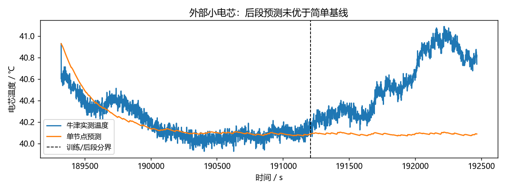
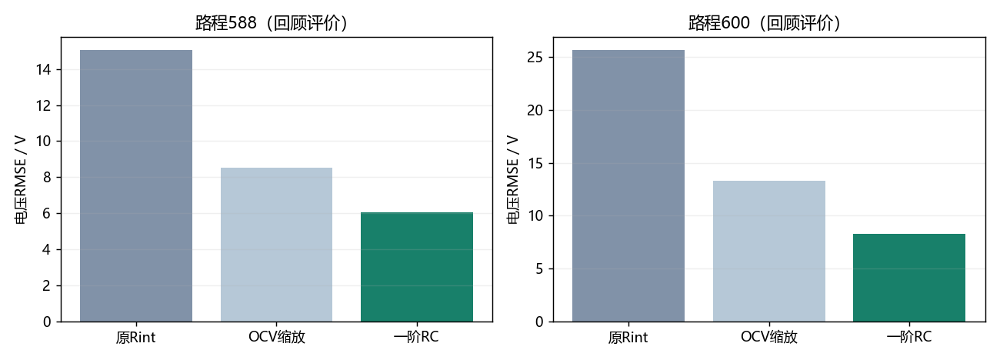

# 五项问题的试验结果与当前选择

这轮完成了外部数据试用、测温处理试验和新电压模型比较。结论：**电压方案有改善；滚阻与本车真实热精度未解决；容量透明双口径；测温采用误差裕量并保留失败。**

## 1. 滚动阻力：试过，暂不替换

EPA的原始458行是测试记录。按预先规定的重量范围及配置去重等规则得到10个配置，不能称为10款本车同类纯电车；Electricity也可能含混动车电动模式。使用Target A/B/C，未混用测功机Set系数。

公式为$F=A+Bv+Cv^2$。统一换成N和m/s后，A对应的等效常数系数中位数为0.007548。它包含轮胎之外的阻力，所以只是外部参照。

固定此值再重新训练其余参数，训练综合误差增加35.88%；575能耗APE由5.41%升至11.53%，596由1.44%升至4.14%。**不用这个值替换本车Cr。** 该比较提示原低速阻力偏低，但不同车的数据不能证明本车真值。道路坡度、传动损耗、附件负载和电池模型也可能影响参数，当前不作单一归因。

## 2. 容量：透明处理已落实

160 Ah×375 V约60 kWh，与30 kWh有冲突。按用户确认：问题一保留160 Ah参考，80 Ah作为30 kWh能量等效对照，正文披露矛盾。两者不能解释成已证实的“标称/可用”关系。

25℃CLTC初始SOC80%时，两种情形能耗均约14.0542 kWh/100 km，终SOC分别约76.53%与73.04%。只说明这个工况，不能推广为所有控制与长程不受影响。辨识得到的有效容量也不当作官方容量勘误。

## 3. 真实温度：实际试用，未达到要求

下载并解析了牛津原始电芯温度、电流、电压。它来自740 mAh的另一种电芯、40℃温箱，不能直接换算成本题电池包温度。

试验用前60%动态放电数据训练单节点热模型，后40%连续预测，没有用后段真实温度修正预测。后段RMSE：物理简模0.543℃；沿用训练末温度0.532℃；沿用训练均温0.461℃。**简模没有优于简单基线，不迁移其参数，也不再加复杂度强行拟合。** 这里只有同一电芯同一循环的后段检查，连独立电芯验证都未达到，更无法证明本车0.1℃精度。



## 4. 温度传感器偏差：建议现在就这样处理

你目前做的是仿真，附件没有真实温度，因此没有依据反推出真实传感器偏差。**论文采用“误差范围内保持舒适”，把真实24±0.1℃作为探索目标，不作为必须实现的承诺。**

具体做法：假设偏差±1℃、噪声±0.05℃；目标读数留1.1℃裕量；基准和优化策略使用相同误差与相同控制边界；比较能耗时另查末温差和未消除的热量。比如读数24℃，在这个假设下，真实温度可能约22.95—25.05℃，应判断是否仍处舒适范围。

“±1℃”是工程试验设定，未被真实校准证明。原观测器仍保留作对照，未知乘员热与传感器偏差可能互相冒充，不把估出的偏差当成已查明的真值。

新60组试验中，59/60满足舒适性、电池温度、启停间隔、功率和原电池终态条件；真实24±0.1℃为0/60。仍失败的案例：

- 环境-10℃，conductance_plus20pct，偏差1℃，optimized；未通过项：cabin_comfort

30个配对中29个双方满足以上条件。额外计入剩余温差和传感器误差预算的理想热修正后，20个配对仍有正节省，这20个也都满足上述配对条件；低温10个配对均不再有正节省。**低温收益暂不作为稳健节能结论，低温舒适性失败照实保留。** 热修正依赖模型和COP，不是实际停车耗电的替代，也不是硬件上界认证。

将来若真做实物，再用有溯源精度的参考温度计，做至少两温度点的同位置、同时间对照，分离零偏、斜率与滞后；当前不要求你补不存在的官方数据。

## 5. 电压：采用表现更好的一阶RC方案

通俗地说，旧模型只计“电流一来立刻压降”；新模型还计“持续用电后积累、停用后慢慢恢复的压降”。这就是RC支路表示的极化。它仍根据车速和负载自己计算电流、SOC与电压，不逐时拿真实电流充当预测。

先处理前四项，再只用575/596训练。两个初值按训练目标选解并冻结，然后算588/600；两段数据以前都看过，所以称回顾评价。

| 路程 | 模型 | 电压RMSE/V | 能耗APE/% | SOC RMSE/百分点 |
|---|---|---|---|---|
| 588 | 原Rint | 15.038 | 0.826 | 2.661 |
| 588 | OCV缩放 | 8.540 | 0.925 | 2.611 |
| 588 | 新一阶RC | 6.033 | 0.784 | 2.642 |
| 600 | 原Rint | 25.659 | 4.407 | 2.559 |
| 600 | OCV缩放 | 13.333 | 4.422 | 2.561 |
| 600 | 新一阶RC | 8.303 | 4.363 | 2.592 |

**本轮推荐电压预测用一阶RC。** 它在两个路程都比OCV缩放方案的电压RMSE降低超过10%；能耗APE略降，SOC与原模型差异小于预设0.2个百分点。原Rint及OCV缩放两版全部保留。



参数：$R_0=0.005000$ Ω、$R_p=0.204019$ Ω、时间常数约7.53 s；有效容量71.83 Ah、OCV缩放0.57923。Cr与R0仍贴搜索下界，不能宣称物理参数被准确辨识。7项解析检查及4路步长检查通过，子步最大电气守恒残差约1.4×10⁻¹¹ W。RC电容会储能，程序已把这部分与发热分开核算。

**使用范围：** 推荐用于本轮电压预测比较。旧问题一、节能控制、长程和参数区间仍由各自冻结模型支持；没有重做RC版控制寻优及300次区间，不能把旧节能率标成RC结果。低SOC、不同车辆和真实温度仍缺独立验证。

## 文件与复现

全部新实验位于`records/experiments/extension_v1/`，原数据、预运行协议和哈希、冻结参数、60组试验和所有失败均保留；输入附外部对象说明及牛津原README/许可。

```powershell
python scripts/run_extension.py
python scripts/recompute_extension.py
```

第一条核对并读取已有结果、重建说明和工作台；结果缺失时按协议运行。第二条建立隔离副本，从输入完整重算本轮实验并逐项核对。原`python reproduce.py all`仍复现旧主实验。

## 外部引用

EPA. Data on Cars Used for Testing Fuel Economy, 2026 Test Car List（2026-01-21版），https://www.epa.gov/compliance-and-fuel-economy-data/data-cars-used-testing-fuel-economy 。

Birkl C. R., Howey D. A. Oxford Battery Degradation Dataset 1, 2017, DOI:10.5287/bodleian:KO2kdmYGg；Birkl, Diagnosis and Prognosis of Degradation in Lithium-Ion Batteries, Oxford PhD thesis, 2017。ODC-ODbL1.0/DbCL1.0，原README与版权说明保留。
