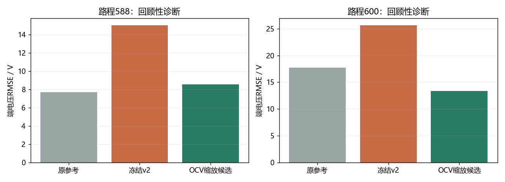
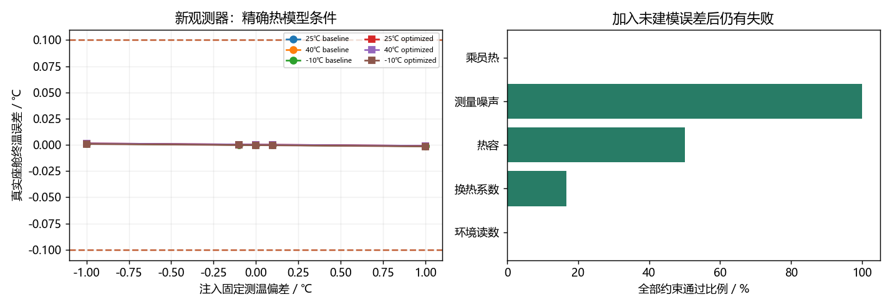

# 问题修复与结果说明

本轮已实际尝试四项技术改进。原实验、论文和数据没有删除；新结果单独归档。用户决定人工部分自行完成，本轮没有把这个意向写成已经人工完成。

## 先看结论

| 问题 | 当前结果 | 能说明什么 |
|---|---|---|
| 低电量电压预测 | 部分改善，未完全解决 | 两路程误差明显下降，仍缺宽SOC实测证据 |
| 滚阻参数可靠性 | 本轮未解决 | 放宽下界后仍贴零，允许负值后出现非物理解 |
| 测温偏差下终温 | 精确模型内改善；真实精度未解决 | 30/30模拟通过；有热参数/热源误差时仍失败 |
| 高温180分钟恢复 | 新策略达到原比较门槛 | 两小时停车后温差-0.062317℃；不是实车验证 |
| 电池容量冲突 | 待官方说明 | 无法用程序判定30kWh还是160Ah为正确额定值 |
| 实车温度准确性 | 缺实测，无法确认 | 仿真收支正确不能代替真实测温 |

## 一、电压：让曲线斜率适应训练数据

原模型只允许整条开路电压曲线上下移动。新方案再增加一个所有路程共用的缩放系数，保留曲线单调性，使用模型预测SOC计算电压，不读取逐时真实SOC作为预测答案。

$$U_{oc}(z)=U_{ref}(0.95)+s[U_{ref}(z)-U_{ref}(0.95)]+d.$$

通俗解释：原来只允许“把尺子整体抬高或降低”，现在也允许调整刻度的疏密。只用575/596训练，预先声明两个初值，按训练目标选解并冻结，再评价588/600；两者均是回顾性诊断，不是新增盲测。

| 路程 | 电压RMSE / V | 能耗APE | SOC RMSE / 百分点 |
|---|---|---|---|
| 588 | 15.038 → 8.540 | 0.826% → 0.925% | 2.661 → 2.611 |
| 600 | 25.659 → 13.333 | 4.407% → 4.422% | 2.559 → 2.561 |

缩放系数为0.683378。能耗误差略有上升，SOC并非处处改善，因此不替换原主结果，也不声称整个电池模型已准确。训练SOC仍主要在87.68%以上，低SOC外推缺少直接约束；候选模型单独保留供后续研究。



## 二、滚阻：降低边界也没有得到可信参数

新电压方案仍将Cr估到0.003下界。继续只用训练数据做两种诊断：

- 将下界放宽到0，Cr≈3.42e-13，仍贴下界。
- 仅为诊断允许负值，Cr≈-0.000528977；负滚阻不符合这里的车辆模型，不采纳。

通俗解释：算法想用“几乎没有滚动阻力，甚至负阻力”补偿其他误差。把下界改小不能让这个数自动变得可信。固定Cr后重拟合其余参数的训练目标也已保存，属于失配和耦合诊断，不冒称置信区间。

本轮没有解决。进一步需要道路坡度/风况、独立滑行或轮端阻力测量，以及更可靠的电池/附件功率标定；现有证据不足以把问题归结为某一个确定原因。

## 三、测温：新增“估计温度和偏差”的观测器

新控制器同时估计座舱真实温度和固定传感器偏差。它只接收带偏差读数、环境与已执行功率；初始估计取第一条带偏差读数，初始偏差估为0，不偷看隐藏真值或注入偏差。

$$C_c\dot T_c=H_c(T_a-T_c)+q,\qquad y=T_c+b,\qquad\dot b=0.$$

通俗解释：温度计可能总是高报1℃。程序结合“开了多少暖风、房间应当怎样升温”，逐渐判断读数偏了多少。这个方法依赖热模型和热量输入足够准确。

三温度、两种策略、五个偏差共30次精确模型试验，30次满足全部约束；最大真实座舱终温误差0.001414℃。原来±1℃下失败的设计情况已重新检查。

为避免只展示理想情况，另做60次压力试验：

| 未知误差 | 全部约束通过数 |
|---|---|
| ambient_sensor_plus0.5C | 0/12 |
| cabin_conductance_plus20pct | 2/12 |
| cabin_heat_capacity_plus20pct | 6/12 |
| measurement_noise | 12/12 |
| occupant_heat_plus50W | 0/12 |

合计20/60通过，失败全部留档。未知乘员热量和固定读数偏差在稳态可能产生同样的读数，观测器不能无条件区分二者。所以已改善仿真控制，仍未完成真实传感器校准，也不能承诺真实0.1℃精度。



## 四、高温恢复：把部分补冷提前到到达前

新规则在已知计划到达前1200秒，将高温电池冷却启停阈值收紧到31.1℃、回差0.2℃；停车继续使用双方共同策略。基准和优化两方使用同样的回温规则、温度观测器、硬件与约束，所有耗电都计入总账。

通俗解释：原来把较多余热留到停车后处理，现在提前处理一部分。收益可能减少，但比较的终点状态更接近。

原40℃、驾驶180分钟案例，两小时停车后两策略电池温差0.225357℃；改进后为-0.062317℃，门槛仍是0.2℃，没有放宽。该案例总账节能率为11.086%，其约束状态为True。

| 90分钟驾驶+两小时停车 | 新策略总账节能率 | 电池终温差 |
|---|---|---|
| 25℃ | 11.835% | 0.010048℃ |
| 40℃ | 9.422% | 0.048215℃ |
| -10℃ | 0.699% | -0.002817℃ |

两套参数、三温度、三驾驶长度的两小时停车配对，18/18达到原热接近条件。0.5→0.25秒的18项检查中18通过。另有30/35/45℃与60/120分钟的迁移诊断，6/9检查点达到热接近条件；全部检查点和失败均保留，迁移诊断不等于独立实测验证。

## 五、怎样复现和继续

新代码：src/bev/remediation.py、remediation_bounds.py；单独解析核查：checks/remediation_checks.py。协议：configs/remediation_protocol.json。完整结果：records/experiments/remediation_v1/；摘要：records/remediation_summary.json。

在工程根目录安装既有依赖，运行：

```powershell
python run.py improve
```

默认核对来源并读取已有冻结新结果；不会重新优化全部旧实验。从交接包重新计算本轮实验，用`python reproduce.py improve`，它创建隔离副本、保留原新实验记录后重算。原`all`仍重现旧主实验，原34项检查与本轮6项解析检查分别统计。

原第七阶段论文及压缩包保留为历史；新论文补入本轮结果和局限。人工工作由用户自行开展，当前没有新增实际人工完成记录。视频仍暂缓。
