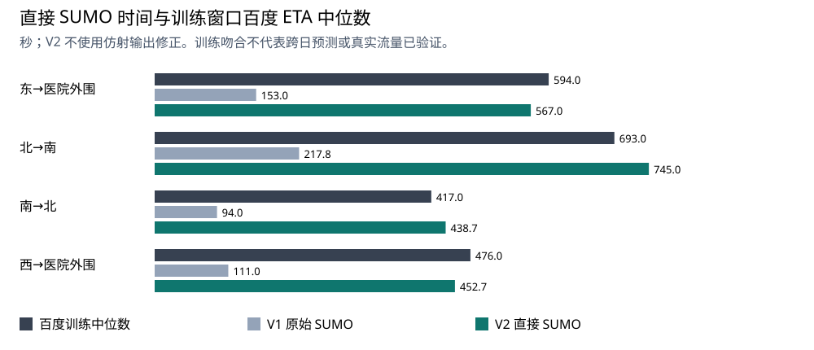

# V2：参数来源、路网修正与 SUMO 内部反演

## 先用通俗的话说明

用户指出的问题成立：地图位置画对了，并不等于交通时间已经对。原先在仿真结果外乘系数、加常数，只能做经验时间换算，不能补上缺失的车流、信号和路口行为。本轮改成调整仿真输入、真正重跑 SUMO，再直接比较车辆在网时间。百度提供的是预计时间，仍不是现场车辆计时。

还修正了两处同一物理道路被折线采样差异拆成重叠道路的问题。V2 的外部边/允许转向数是305/308，V1为307/310；保存旧边到规范边链映射、几何残差、源路径连续性和终端可达关系检查。没有通过关闭碰撞检测来通过验收。

## 数据依据

逐项审计见 `research/parameter_audit/README.md` 与参数登记表；涵盖48项参数/隐含假设、222个配置叶字段和26项一手资料。

黄浦区政府公示的瑞金医院相关项目环评，在2025年9月监测中记录瑞金二路昼间20分钟207辆车，折算621辆/小时。它是当地历史量级参考；路段、方向、年份、车型与当前六OD不同，不能直接当2026周末流量。本轮增加三条经过共同段的OD各200辆/小时、合计600的条件参考，并保留更低/更高需求。30km/h是环评噪声预测用值，不是已核实法定限速。

615个百度步骤均可按有向几何匹配，但步骤时间几乎与路线总时间同比变化，不作为额外独立样本。训练48条路线，只有4组重复OD。终点3米/20秒一类值包含综合时间成本，不用于推断真实限速。

## 方法与可识别性

采用 SUMO 仿真循环优化：设定候选需求 → 调整瑞金二路、建国西路及其他走廊三组有效运行约束 → 实际仿真 → 比较四条路线训练中位ETA → 保留误差小且没有碰撞、传送、丢弃和未完成车辆的解。使用有界坐标搜索，不声称执行了 demandify 遗传算法。

目标函数为四条路线相对中位数误差的均方：J(θ|q)=mean[((T_SUMO,r(θ,q)−median(T_Baidu,r))/median(T_Baidu,r))²]。需求q逐档剖面化，θ是三组有效运行约束。没有 αT+β，也没有人为停车补齐时间。

有效运行约束会综合吸收未能分解的信号、沿街干扰和运行速度影响。它能用于条件交通实验，不能解释成真实道路限速；较好的ETA一致性也不能证明真实红绿灯、车道、每分钟车数和排队成因已被唯一恢复。

实际评价 221 个候选，21 个未通过物理/完整性/探针入网条件。训练误差最小剖面：headway_30。允许各OD中位误差≤15%是工程一致性筛选条件；20秒探针入网阈值源于最短训练中位417秒的约5%，在烟测后、正式搜索前确定，所有候选统一执行。

| 路线 | 百度训练中位数(s) | V1直接SUMO(s) | V2直接SUMO(s) |
|---|---:|---:|---:|
| 东→医院外围 | 594.0 | 153.00 | 567.00 |
| 北→南 | 693.0 | 217.75 | 745.00 |
| 南→北 | 417.0 | 94.00 | 438.67 |
| 西→医院外围 | 476.0 | 111.00 | 452.67 |

## 时间留出评价

参数只用训练窗口拟合；保留窗口不重拟合。V1已看过这些留出结果，所以本轮是回顾性时间留出，不能称全新盲测或前瞻验证。固定一套交通状态跨日预测，不能自动跟随当天需求变化。

| 窗口 | 样本数 | V2直接SUMO MAE(s) | 训练中位数基准MAE(s) |
|---|---:|---:|---:|
| cross_day_holdout | 96 | 206.29 | 200.46 |
| same_day_exploratory | 16 | 124.75 | 119.75 |
| training | 48 | 69.58 | 57.60 |

## 第三个问题：缺失车流与排队怎样估计

下面是给定候选需求和已标定有效约束时，实际SUMO产生的车流和等待。不同需求若都能匹配ETA，就必须同时保留，不能因为某一组数值漂亮就把它写成现实真值。范围是本轮试过的有限候选包络，没有统计置信区间含义。

| 需求剖面 | 每OD辆/分钟 | 全网请求辆/分钟 | 瑞金断面背景辆/小时 | 普通车平均停车等待(s) | 通过一致性筛选 |
|---|---:|---:|---:|---:|---|
| headway_60 | 1.00 | 6.00 | 180.0 | 0.03 | 是 |
| headway_30 | 2.00 | 12.00 | 360.0 | 2.12 | 是 |
| historical_scale_18 | 3.33 | 20.00 | 573.0 | 16.63 | 否 |
| headway_15 | 4.00 | 24.00 | 690.0 | 40.84 | 否 |

完整条件状态、全网唯一停车车辆的逐秒均值/最大值、未完成数及逐车来源见 `conditional_states.json`。唯一停车车辆数取自SUMO每秒summary.halting；逐道路另提供边累计停车占用指标，短边车身跨越会重复计数，不能当唯一排队车数。断面流量只计同一条边的穿越，避免把同车经过多个几何分段重复加总。

真实信号配时、各路口红灯等待及排队成因仍无法由四条平台ETA唯一识别。本轮不会编造信号周期；若要识别，需要路口车次/轨迹/信号观测等额外约束。上海公开车辆轨迹、pNEUMA/NGSIM等可用于算法和先验验证，不能搬用为瑞金医院当天实测。

## 第二问拥堵取值修订

原68.735米事件段的1/0.5m/s无直接来源。修订为西侧到医院路线中完整瑞金二路步骤：平台276m、模型278.665139m、19条边。仅训练12个样本的有效速度中位6.0041km/h，p25=4.9473、p10=4.2317，因此中度/较强倍率为0.82399/0.70480。倍率乘在已校准运行约束上，属于同几何观测支持的情景代理，不是把平均速度当真实点限速。

其中约209.93m属于共同必经段，备选只能绕过约68.74m，不保证改道有收益。300/600/900秒事件长度、任务时刻、45/180秒控制上限仍是实验设计变量；来源见 `research/parameter_audit/scenario_basis_v2.md`。治理重跑见 `outputs/governance_v2/`，不得沿用V1的8.77%或60秒收益当作V2结论。

## 修订后治理结果

已完成44组实际SUMO对照、32个配对。所有车辆到达且未检测到碰撞/传送/丢弃。A全部没有改道；下面只列通过训练时间筛选的需求档中B相对A的结果。正数表示耗时增加。

| 需求档 | 拥堵强度 | 普通总时间变化(车·秒) | 保障任务时间变化(秒) |
|---|---|---:|---:|
| headway_60 | step_q25 | +697 | +0 |
| headway_60 | step_q10 | +631 | +0 |
| headway_30 | step_q25 | +1437 | +30 |
| headway_30 | step_q10 | +1496 | +25 |

本轮通过筛选的情景不支持现有B策略能缩短保障任务；普通交通成本全部增加。不能将旧版假设情景的治理收益继续作为新模型结论。未通过时间筛选的18/15秒需求仍完整保留，但只作诊断。

A不改道有可核算原因：完整事件段约209.93m是两候选共同必经，成本在比较中抵消；备选只能避开68.735m，却多走约717.126m。在60/30秒需求档，降速倍率须低到约0.1312/0.1180才使改道代价更小；训练得到的0.8240/0.7048不接近这个阈值。推导及来源见 `outputs/governance_v2/route_choice_explanation.md`。没有通过放大事故强度制造收益。

## 依据与复现

- SUMO官方仿真循环标定示例：https://sumo.dlr.de/docs/Tutorials/Calibration/San_Pablo_Dam.html
- demandify作者项目（思路参考，本轮未安装执行）：https://github.com/aonurakman/demandify
- FHWA微观交通模型标定要求：https://ops.fhwa.dot.gov/publications/fhwahop18036/chapter5.htm
- 本地环评、上海公开轨迹和其余资料：`research/parameter_audit/sources.json`；文件摘要已保存。

复现脚本：`python3 scripts/prepare_observations_v2.py --run`、`python3 scripts/normalize_network_v2.py --run`；已有冻结结果勿覆盖。内部标定入口 `python3 scripts/calibrate_inverse_v2.py fit`，已有fit时会拒绝覆盖；评价 `python3 scripts/calibrate_inverse_v2.py evaluate`，汇总 `python3 scripts/summarize_inverse_v2.py`。完整搜索保留每次参数、真实SUMO XML、无效原因、来源及产物摘要。

AI参与数据审查、程序和模型构建；队员仍需依赛方要求独立开展必要核心工作及实质复核。
