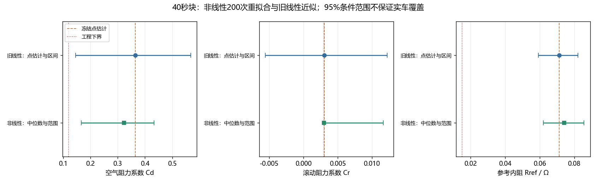
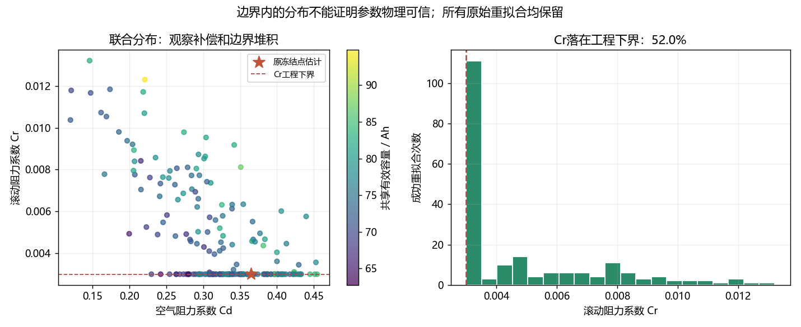
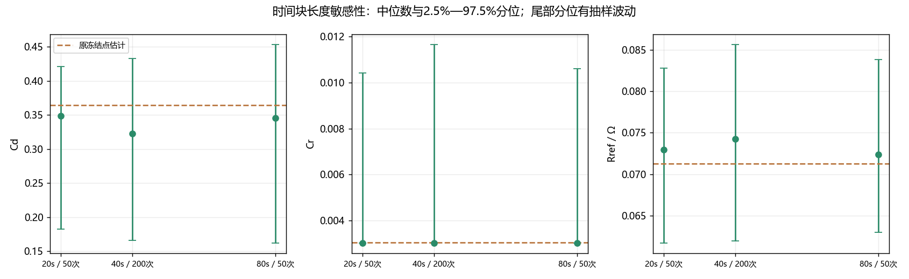
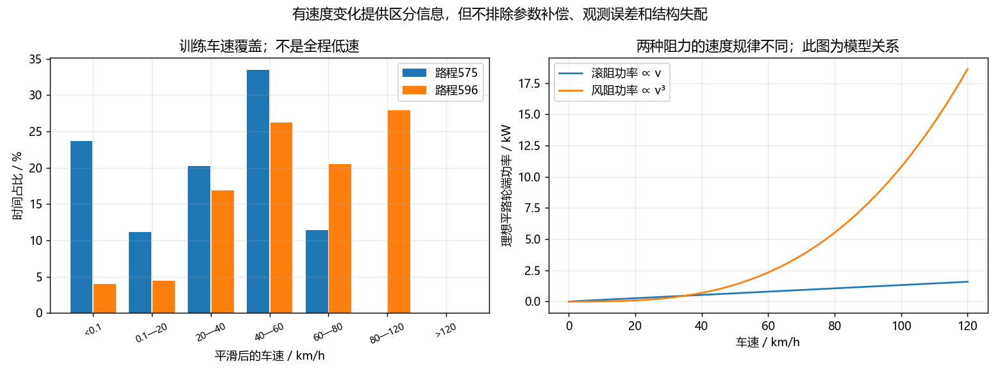

# C题阶段五实际进展

日期：2026年10月18日，北京时间。命令：`python run.py stage5`（或`reliability`）。本阶段仅使用训练575/596；不重新评价588/600，不替换原校准参数和控制规则。

## 结论先看

已完成300次真正的非线性约束重拟合，300次通过既定求解状态与模型有限性检查；新增训练车速覆盖和实际雅可比几何分析。**滚阻可靠性仍未解决。** 主40秒块中，Cr有52.0%落在原工程下界附近；主分位范围为[0.003, 0.0116668]。边界堆积不能解释为参数准确，原线性区间越过零的失败信号也保留。

训练路程并非一直低速：575/596平滑后的最高车速约74.94/117.76km/h，局部两参数方向仍为满秩。因此不能把Cr问题完全归因于“没有高速数据”，也不能声称两个参数在数学上绝对不可区分。参数补偿、近边界估计和既有结构失配共同限制可信度。

## 新增分析怎样做

1. 固定原模型、输入车速/环境/实测附件负载、初始SOC与假定初温、通道尺度和五参数工程边界。
2. 在原冻结参数处重新计算训练残差，与原线性化文件逐项核对一致。这里只计算训练数据，没有将未来SOC/I/U喂给正向模型。
3. 同一路程、同一时间块内，SOC、电压和功率窗使用同一随机正负号；不同路程独立分块。整路程总能量残差先拆回功率窗的时间贡献，再使用同一组符号汇总。
4. 以冻结预测为中心构造扰动目标，重新求解整个非线性模型，仍限制在原工程边界。主40秒块200次，20/80秒各50次，共300次；预设种子固定。
5. 每20次附加一个不同初值复算，共16个多初值审计；记录每次状态、代价、迭代数、边界及失败，不因结果不好换抽样。

运行前协议、代码、数据来源清单与原冻结哈希记录于`records/reliability_freeze.json`。计算断点只允许在相同指纹下继续，随机符号也单独保存，便于重现。

### 中心化的公式与人话

设原训练复合残差为$r(\theta)$，冻结估计为$\hat\theta$，分块带符号残差贡献为$B\xi$。每次求解：

$$\min_{\theta\in[\ell,u]}\frac12\left\|r(\theta)-r(\hat\theta)+B\xi\right\|^2.$$

通俗地说：从原冻结预测出发，给误差按时间段换正负号，再看看重新拟合的参数会跑到哪里。减去原残差是为了正确地围绕冻结预测生成伪响应；不是直接在原拟合目标上再随意加一层误差。

这是固定输入条件下的复合残差重抽样。各通道保持块内符号一致、总量与功率窗代数一致，但不宣称每个伪响应都对应一辆物理上真实存在的车。没有重抽样车速误差、温度初值、热模型结构或不同车辆。

## 参数范围：保留旧结果，再做非线性对照

主分析40秒块。旧线性区间为1000次局部线性块wild近似，新非线性范围为200次重拟合的2.5%—97.5%分位。新图用中位数表示分布中心，**中位数没有替换原点估计**。

| 参数 | 原冻结值 | 旧95%线性条件近似区间 | 新95%非线性百分位范围 | 新分布中位数 | 落在工程下界比例 |
|---|---:|---|---|---:|---:|
| Cd | 0.364431 | [0.145452, 0.567248] | [0.166055, 0.433114] | 0.322486 | 0.5% |
| Cr | 0.0030244 | [-0.00554887, 0.0122424] | [0.003, 0.0116668] | 0.003 | 52.0% |
| Rref / Ω | 0.0712844 | [0.0591464, 0.0822121] | [0.061969, 0.0856476] | 0.0742336 | 0.0% |
| 有效容量Q / Ah | 74.4145 | [63.7133, 84.0805] | [66.1809, 85.1444] | 74.9991 | 0.0% |
| OCV偏移 / V | -8.08904 | [-9.31259, -6.79106] | [-9.22632, -6.79463] | -7.93484 | 0.0% |

下界判定使用“距离原下界不超过参数搜索跨度的$10^{-6}$”，近下界另以跨度1%统计；这些是数值诊断定义。Cr原下界0.003由工程设定给出，**不能把0.003改写成数据证明的真实最小值**。受约束的非线性分布变得非对称、在边界堆积，不能据“不再穿零”声称问题解决。

| 参数 | 落下界 | 距下界不超过搜索跨度1% | 落上界 |
|---|---:|---:|---:|
| Cd | 0.5% | 1.0% | 0.0% |
| Cr | 52.0% | 54.5% | 0.0% |
| Rref / Ω | 0.0% | 0.0% | 0.0% |
| 有效容量Q / Ah | 0.0% | 0.0% | 0.0% |
| OCV偏移 / V | 0.0% | 0.0% | 0.0% |

题目要求至少两个参数的置信区间。论文应完整列出原条件近似区间及其假设，用新非线性对照说明边界和非线性影响；这些结果均无真实总体覆盖保证。尤其不可把工程搜索范围直接称作置信区间。若称为近似统计区间，须同时声明固定模型、残差块依赖等条件，保留有限抽样和失配局限。

主重抽样Cd/Cr经验相关系数约-0.681356。它描述本重抽样机制下的共同变化，不是真实参数的总体相关。原训练剖面仍可用于解释补偿；没有将剖面代价直接换算成卡方置信区间。

## 块长与数值稳定性

| 块长s | 成功/请求 | Cd百分位范围 | Cr百分位范围 | Rref百分位范围Ω | Cr落下界 |
|---:|---:|---|---|---|---:|
| 20 | 50 / 50 | [0.182674, 0.420921] | [0.003, 0.0104157] | [0.0616668, 0.0827956] | 60.0% |
| 40 | 200 / 200 | [0.166055, 0.433114] | [0.003, 0.0116668] | [0.061969, 0.0856476] | 52.0% |
| 80 | 50 / 50 | [0.16156, 0.45353] | [0.003, 0.0106131] | [0.0629751, 0.0837912] | 56.0% |

只有两条训练路程，不是两百辆独立车辆。20/80秒各50次只能作粗略敏感性检查，95%尾部每端约1—2个样本；40秒200次每端也只有约5个样本，分位端点会波动。没有把300次计算称为300次实测。

把主200次成功结果按生成顺序分成两半，比较两半的上下尾分位，得到最大端点差：

| 参数 | 两半样本尾分位最大差（参数单位） |
|---|---:|
| Cd | 0.0258216 |
| Cr | 0.00113047 |
| Rref / Ω | 0.00171323 |
| 有效容量Q / Ah | 2.00093 |
| OCV偏移 / V | 0.185015 |

这只是蒙特卡洛波动诊断，不是区间端点的置信限，也不构成覆盖证明。

多初值审计最大代价差0.0401732，最大相对代价差0.622250%。已有局部数值差异，不能声称全部初值收敛至同一解或证明全局最优；按预设规则保留审计中代价较低的成功解。未接受重拟合0次；全部原始状态见`nonlinear_wild_draws.csv`，失败不能被悄悄替换。

## 训练输入到底提供了哪些信息

对平路理想路阻，滚阻功率近似随车速一次变化，空气阻力功率随车速三次变化：

$$P_{road}=mgC_rv+\frac12\rho A C_dv^3.$$

**人话解释：** 只在一个速度开，两个阻力旋钮容易互相补偿；增加不同速度，尤其同时覆盖低速与高速，通常有助于区分。但真实数据还包含附件用电、驱动非线性、缺口和电池模型误差，不能只看车速就认定参数可靠。

| 路程 | 最高平滑车速km/h | 近静止时间 | ≥80km/h时间 | 准稳态时间 | 原观测>5秒缺口跨越时间 |
|---|---:|---:|---:|---:|---:|
| 575 | 74.94 | 23.67% | 0.00% | 15.63% | 11.35% |
| 596 | 117.76 | 4.05% | 27.90% | 27.62% | 0.00% |

准稳态定义为车速≥10km/h且加速度绝对值≤0.1m/s²，只是可重复的描述性筛选；不代表独立滑行或道路阻力台架试验。缺口内车速来自插值和平滑，不能把高分辨率网格当成新增实测点。

下表两列先归一化，余弦接近1表示局部响应相似；条件数越大表示该线性化方向更难区分。实际雅可比来自原冻结复合残差，最后一行投影掉Rref/Q/OCV的局部补偿方向。

| 诊断对象 | 两列秩 | 列余弦 | 列归一化条件数 |
|---|---:|---:|---:|
| 合并训练：理想路阻功率列 | 2 | 0.822931 | 3.208588 |
| 实际复合残差：Cd/Cr列 | 2 | 0.873070 | 3.841450 |
| 实际列扣除R/Q/OCV补偿方向 | 2 | 0.864079 | 3.703307 |

两列满秩只说明在这个局部近似下不是完全重合。它不证明现实参数具有足够精度，也不能解释为全模型的全局可辨识性。风阻/滚阻存在补偿，但本数据不是简单的“全程低速、完全不可分离”。电压跨SOC迁移失败、容量冲突、热状态未知和Cr靠边界仍需共同报告。

## 已验证与尚未解决

本轮新增6项解析核查，总计34项程序检查通过，涵盖块内跨通道依赖、总能量贡献一致、线性已知解、非线性正确中心与边界效应、恒速路阻不可分与变速可分、训练路程限制。冻结残差逐项重现；原参数、规则及既有长程结论未改变。

尚未解决真实OCV跨SOC精度、Cr物理可靠性、温度实测与传感器校准；600仍仅为回顾检验。没有新增盲测、MPC、最终论文或正式比赛视频。

## 结果文件与后续

- `results/tables/nonlinear_reliability.json`：所有重拟合、区间、审计及激励统计。
- `nonlinear_wild_draws.csv`、`nonlinear_wild_ranges.csv`：逐次结果及范围表；`nonlinear_wild_signs.npz`保存随机符号。
- `records/reliability_freeze.json`、`reliability_checkpoint.json`：运行前协议指纹与可恢复断点。
- [参数可靠性通俗说明](../docs/参数可靠性与非线性区间通俗说明.md)：给队员阅读与复核。

下一步整理三问的共同证据表，开始正式论文、四环节视频及提交支撑材料。优先准确回答三问、写清限制；不再为追求漂亮参数而修改已查看结果对应的口径。
