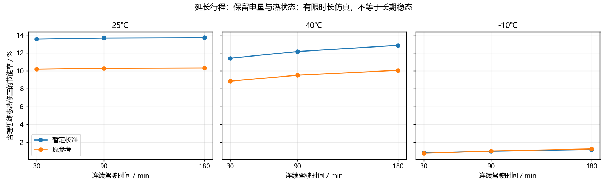
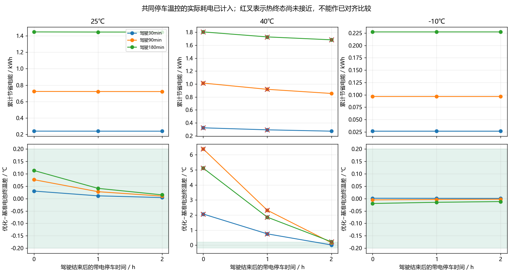
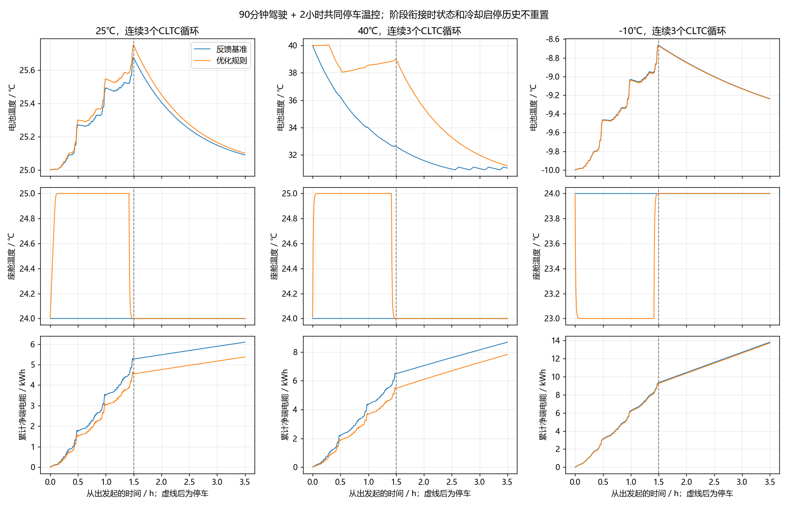
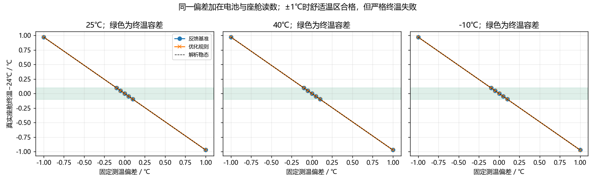

# C题阶段四实际进展

日期：2026年10月18日，北京时间。命令：`python run.py stage4`（或`durability`）。本阶段只验证原冻结控制，不重新调参。完整实验协议与计算代码在运行前记录于`records/durability_freeze.json`。

## 先看结论

连续驾驶30、90、180分钟后，冻结规则在本模型内仍节电；将停车温控耗电计入后，收益有所减少。**90分钟驾驶+2小时共同停车温控**，25/40/−10℃分别节约约0.721/0.855/0.097kWh，总账节能率约11.835%/9.850%/0.699%，且两套策略的热终态达到预设接近条件。

**高温180分钟案例仍未完全对齐。** 40℃、暂定校准模型在停车2小时后电池终温差0.2254℃，超过运行前声明的0.2℃，不计入已对齐热终态的有效比较；没有事后放宽阈值。±1℃固定测温偏差的12个单策略案例均未达到24±0.1℃真实座舱终温；±0.1℃在精确模型中通过，但真实校准与误差预算仍待完成。

长行程中大量时间已低于训练SOC范围，热状态也没有实测验证。以下均为有限时长、给定假设下的模拟证据，不能称为实车节能率或无限长时间稳态保证。

## 实验怎样比较

- 使用同一动力/电池/双热节点模型；保持阶段三参数、控制规则、5秒反馈和30秒冷却最小开关间隔不变。
- 1/3/6个公开CLTC-P循环，30/90/180分钟、约14.480/43.439/86.879km。只合并公共零速端点；循环间不重置SOC、温度、控制启停历史。
- 初始SOC94%、电池温度=环境、座舱预调24℃，预调耗电排除。多循环仅在整个行程结束前300秒回24℃，没有在每个小循环末尾人为复位。
- 分别使用暂定校准v2与原参考160Ah参数，共36条完整行程；不将两套模型的绝对能耗混算为节能率，也不将模型差异称为置信区间。
- 停车期间两策略共用同一温控：座舱24℃；40℃环境电池恒温目标31℃、25℃环境25.1℃，回差半宽0.1℃；低温不主动冷却电池。上述均为新增工程设置。
- 停车仍保留低压负载、乘员热量和对应太阳热量，所有附件从电池取电；没有外接电源、没有充电。它表示带电温控停留，不能解释为熄火、无人、关空调停车。
- 原共同约束仍须满足；另声明热终态接近条件：两策略电池终温差≤0.2℃、座舱差≤0.02℃，且各自真实座舱终温24±0.1℃。SOC允许不同，差异对应剩余电量。
- 端电能为UI净积分。保留原理想热修正作参照；实际停车已经计入的耗电不重复加算，修正只估计检查点尚存的相对热差。

## 连续驾驶结果

| 环境℃ | 驾驶min | 校准模型原始节能率 | 校准模型含理想热修正 | 原参考含理想热修正 | 校准模型电池终温差℃ |
|---|---:|---:|---:|---:|---:|
| 25 | 30 | 13.600% | 13.539% | 10.178% | 0.0302 |
| 25 | 90 | 13.709% | 13.658% | 10.281% | 0.0761 |
| 25 | 180 | 13.737% | 13.698% | 10.316% | 0.1131 |
| 40 | 30 | 14.762% | 11.409% | 8.842% | 2.0676 |
| 40 | 90 | 15.654% | 12.151% | 9.501% | 6.3874 |
| 40 | 180 | 14.264% | 12.828% | 10.055% | 5.1149 |
| -10 | 30 | 0.846% | 0.846% | 0.801% | 0.0012 |
| -10 | 90 | 1.033% | 1.033% | 1.053% | -0.0054 |
| -10 | 180 | 1.218% | 1.218% | 1.292% | -0.0199 |

表中热修正仍是核算，不表示已经实际冷却。40℃三个驾驶终点的电池热差明显，须连同下表恢复结果理解。规则可行与热终态接近是两个独立条件。

## 停车2小时后的真实模拟总账

下表均为暂定校准模型，能耗含驾驶和完整2小时带电停车，未叠加理想修正。

| 环境℃ | 驾驶min | 基准kWh | 优化kWh | 节省kWh | 总账原始节能率 | 电池终温差℃ | 双方可行且热终态接近 |
|---|---:|---:|---:|---:|---:|---:|---|
| 25 | 30 | 2.570968 | 2.332586 | 0.238382 | 9.272% | 0.0040 | 是 |
| 25 | 90 | 6.094074 | 5.372864 | 0.721210 | 11.835% | 0.0100 | 是 |
| 25 | 180 | 11.374385 | 9.928277 | 1.446108 | 12.714% | 0.0149 | 是 |
| 40 | 30 | 4.479272 | 4.207510 | 0.271763 | 6.067% | 0.0159 | 是 |
| 40 | 90 | 8.677221 | 7.822527 | 0.854694 | 9.850% | 0.1651 | 是 |
| 40 | 180 | 14.912434 | 13.228544 | 1.683891 | 11.292% | 0.2254 | 否 |
| -10 | 30 | 7.590123 | 7.563763 | 0.026360 | 0.347% | 0.0006 | 是 |
| -10 | 90 | 13.820439 | 13.723886 | 0.096554 | 0.699% | -0.0028 | 是 |
| -10 | 180 | 23.142083 | 22.914761 | 0.227322 | 0.982% | -0.0122 | 是 |

54个配对检查点中，54个完成、54个双方均满足原共同约束；其中41个另外满足热终态接近条件。18个“停车2小时”配对中17个满足接近条件。这些检查点来自同一批行程，彼此相关，不能当作54次独立实测。

### 高温案例具体发生了什么

| 驾驶min | 停车h | 累计节省kWh | 基准/优化电池终温℃ | 温差℃ | 已达到热终态接近条件 |
|---:|---:|---:|---:|---:|---|
| 30 | 0 | 0.323608 | 36.2333 / 38.3009 | 2.0676 | 否 |
| 30 | 1 | 0.292399 | 32.2691 / 33.0204 | 0.7512 | 否 |
| 30 | 2 | 0.271763 | 31.0859 / 31.1017 | 0.0159 | 是 |
| 90 | 0 | 1.015014 | 32.6118 / 38.9992 | 6.3874 | 否 |
| 90 | 1 | 0.918605 | 30.9533 / 33.2740 | 2.3207 | 否 |
| 90 | 2 | 0.854694 | 31.0288 / 31.1939 | 0.1651 | 是 |
| 180 | 0 | 1.806069 | 34.8330 / 39.9479 | 5.1149 | 否 |
| 180 | 1 | 1.728868 | 31.7605 / 33.6188 | 1.8583 | 否 |
| 180 | 2 | 1.683891 | 31.0940 / 31.3193 | 0.2254 | 否 |

以40℃、90分钟驾驶为例，驾驶结束节省1.015014kWh，2小时停车后节省0.854694kWh，差额约0.160320kWh被后续恢复消耗。总账百分比还会因双方都支付停车维持耗电而降低；**百分比下降不全部是先前收益被回收**，应同时看绝对节省kWh。

热终态接近允许小幅余热差，并非严格等温。在40℃、180分钟的失败比较点，残余温差不被隐藏；需要另行声明更长恢复实验后才能判断何时达到接近条件。本阶段没有把恢复时长事后改到刚好通过。

## 测温偏差：舒适不等于终温精确

3个环境×7个固定偏差×2种策略，共42个单策略试验；偏差同时加在电池和座舱测量值。只验证既有控制/执行器模型，不覆盖随机噪声、漂移、测点滞后或所有传感器故障。严格共同约束通过30/42；±1℃的12个均失败，但舒适温区仍通过。

| 固定偏差℃ | 最大真实座舱终温误差℃ | 严格终温通过 | 舒适温区通过 |
|---:|---:|---:|---:|
| -1 | 0.971134 | 0 / 6 | 6 / 6 |
| -0.1 | 0.097347 | 6 / 6 | 6 / 6 |
| -0.05 | 0.048804 | 6 / 6 | 6 / 6 |
| +0 | 0.000260 | 6 / 6 | 6 / 6 |
| +0.05 | 0.048804 | 6 / 6 | 6 / 6 |
| +0.1 | 0.097347 | 6 / 6 | 6 / 6 |
| +1 | 0.971134 | 0 / 6 | 6 / 6 |

在热负荷前馈准确、参数恒定且附件不饱和的条件下，令真实座舱偏差为e、测量偏差为b、反馈增益为K、环境换热系数为H，理想稳态满足：

$$e_\infty=-\frac{K}{K+H}b\approx-0.970874b.$$

通俗地说：温度计高报1℃，控制器会把真实座舱调低约0.97℃。继续控更久也不会自动校正温度计。这个公式只是本控制器在给定模型下的偏差传播关系；没有证明所有可能的观测器都无法识别偏差。

±0.1℃偏差的最大真实终温误差约0.09735℃，距离0.1℃阈值只剩约0.00265℃；±0.05℃偏差约0.04880℃。不能用这种理想余量承诺真实车辆。真实严格终温方案需要可追溯校准、独立参照或经过验证的偏差估计，并计入模型、测点与动态误差；当前缺少这些证据，原失败保留。

## 外推范围与程序检查

训练575/596的SOC仅87.68%—100%。下表为暂定校准模型，包含驾驶和2小时停车；“低于训练下界”按时间统计，不是误差估计或失效概率。

| 环境℃ | 驾驶min | 基准/优化最终SOC | 基准/优化低于训练SOC下界的时间占比 |
|---|---:|---:|---:|
| 25 | 30 | 84.72% / 85.58% | 80.8% / 57.5% |
| 25 | 90 | 71.58% / 74.23% | 86.3% / 80.1% |
| 25 | 180 | 51.22% / 56.72% | 90.4% / 86.1% |
| 40 | 30 | 77.76% / 78.76% | 81.5% / 81.1% |
| 40 | 90 | 61.87% / 65.12% | 86.8% / 86.5% |
| 40 | 180 | 37.50% / 44.11% | 90.7% / 90.5% |
| -10 | 30 | 66.01% / 66.11% | 86.0% / 85.7% |
| -10 | 90 | 41.67% / 42.05% | 90.0% / 89.8% |
| -10 | 180 | 3.49% / 4.49% | 93.0% / 92.8% |

最低SOC约3.49%，虽然数学模型没有越出[0,1]，但已经严重超出辨识支持，不能据此确认真实续航或低SOC电压精度。冻结OCV/Cr缺陷和30kWh/160Ah冲突均未解决。

- 自动核查28项通过；新增6项覆盖循环里程/端点、分段状态连续、终点计划不受停车时长干扰、冷却切换间隔继承、解析传感器偏差及不可行比较排除。
- 暂定校准3循环、三温度、两策略、三个检查点，共18项0.5→0.25秒步长检查通过。总电能最大相对差0.000848%，电池终温最大差0.0001447℃。
- 全部完成检查点的DC收支最大残差0.000e+00kWh；电池/座舱累计热平衡残差1.378e-07/2.549e-06J。
- 原始9文件SHA256与阶段三控制冻结均保持不变；参数/规则未重选。没有实测热验证，没有MPC，也未完成正式论文或比赛视频。

## 文件与下一步

原始结果：`results/tables/durability_evaluation.json`，对照表：`durability_comparisons.csv`，传感器表：`sensor_bias_sweep.csv`；3循环完整轨迹在`results/timeseries/durability_*.csv`。

下一步先补问题二的训练内非线性不确定性与速度激励诊断，保留Cr/OCV局限；再冻结论文证据表、写正式论文并制作四环节视频。测温校准和模型外推仍列为未解决问题，不能因为本阶段实验完成就标为已经解决。
